---
title: "Informe Técnico: Desarrollo Web con Arquitectura Hexagonal Desplegado en AWS"
subtitle: "Sistema Integral de Gestión de Citas Médicas (MediCitas) — Taller 3"
author: "Equipo de Desarrollo MediCitas"
date: "Noviembre de 2026"
geometry: "margin=2.5cm"
lang: "es"
toc: true
toc-title: "Índice de Contenidos"
numbersections: true
---


# Introducción y objetivos

El presente informe técnico documenta el diseño, desarrollo, implementación y despliegue del sistema web de gestión de citas médicas denominado **MediCitas**. Este proyecto fue desarrollado en el marco del Taller 3, "Desarrollo web con Arquitectura Hexagonal desplegado en AWS", con el propósito de aplicar patrones de arquitectura de software desacoplados, buenas prácticas de desarrollo backend y frontend, mecanismos robustos de integridad en bases de datos relacionales, e integración de flujos automatizados de mensajería asíncrona mediante agentes inteligentes desplegados en una infraestructura en la nube.

La gestión tradicional de citas médicas en clínicas y centros de salud suele enfrentar diversas problemáticas operativas, tales como la duplicidad de reservas en un mismo horario, la falta de confirmación oportuna por parte de los pacientes, el ausentismo no notificado y la dificultad para reprogramar consultas de forma ágil. Para abordar estos desafíos, se concibió MediCitas como una solución integral que desacopla la lógica de negocio de los detalles de infraestructura, garantizando la consistencia transaccional y facilitando la interacción omnicanal mediante la plataforma web y la aplicación de mensajería Telegram.

## Objetivos del proyecto

### Objetivo general

Diseñar, implementar y desplegar en Amazon Web Services (AWS) una plataforma web para la administración y agendamiento de citas médicas basada en principios de Arquitectura Hexagonal (Puertos y Adaptadores), complementada con un motor de automatización de flujos de trabajo (n8n) conectado a Telegram, asegurando alta disponibilidad, integridad referencial y separación estricta de responsabilidades.

### Objetivos específicos

1. Implementar la lógica del negocio clínico bajo el patrón de **Arquitectura Hexagonal**, organizando el sistema en capas independientes de Dominio, Aplicación, Infraestructura e Interfaces, permitiendo que las entidades y casos de uso permanezcan aislados de motores de bases de datos o marcos web concretos.
2. Modelar una base de datos relacional sobre **PostgreSQL 14+** que garantice la integridad de los datos mediante restricciones avanzadas a nivel de motor, incluyendo exclusiones de traslape temporal (`EXCLUDE USING gist`), borrado lógico generalizado y auditoría histórica inmutable por medio de disparadores (*triggers*).
3. Desarrollar una interfaz de usuario interactiva y responsiva utilizando **React 19** y **Vite**, que provea tableros diferenciados para los roles de administrador, médico y paciente, así como calendarios interactivos y flujos guiados para la reserva de citas.
4. Integrar un subsistema de automatización mediante **n8n** y modelos de lenguaje de inteligencia artificial, habilitando un bot conversacional en Telegram capaz de autenticar pacientes, agendar consultas, enviar recordatorios preventivos y procesar confirmaciones o cancelaciones de forma síncrona y asíncrona.
5. Diseñar y ejecutar una arquitectura de despliegue en la nube de **Amazon Web Services (AWS)** distribuida en cuatro instancias dedicadas de Amazon EC2, configurando grupos de seguridad (*Security Groups*), servidores web Nginx en configuración de proxy inverso, administradores de procesos en segundo plano con PM2 y contenedores Docker para los servicios de automatización.
6. Validar la funcionalidad global de la plataforma a través de una batería de pruebas de integración automatizadas sobre la interfaz de programación de aplicaciones (API REST).


\newpage


# Descripción del sistema y reglas de negocio

MediCitas es una plataforma web para la gestión integral de citas médicas que coordina la interacción entre profesionales de la salud, pacientes y personal administrativo, asegurando la consistencia transaccional y la omnicanalidad a través de la web y Telegram.

## Actores del sistema

1. **Administrador:** Administra usuarios, aprueba cuentas, gestiona consultorios, especialidades, asignaciones médicas y consulta métricas analíticas globales.
2. **Médico:** Configura sus bloques de disponibilidad física, consulta su agenda asistencial y registra la asistencia y notas clínicas de los pacientes.
3. **Paciente:** Se registra en la plataforma, consulta facultativos y especialidades, agenda citas, y gestiona sus reservas (confirmación, cancelación y reprogramación) vía web o Telegram.
4. **Sistema:** Ejecuta tareas programadas en segundo plano: cancelación de citas expiradas, emisión de recordatorios periódicos y auditoría inmutable de estados.

## Catálogo de reglas de negocio

### 1. Usuarios, roles y cuentas (RN-001 a RN-012)

Tabla 1. Reglas de negocio para usuarios, roles y cuentas.

| Código | Descripción de la regla de negocio |
|---|---|
| **RN-001** | Todo usuario tiene asignado exactamente un rol (`admin`, `medico`, `paciente`) y un único estado de cuenta. |
| **RN-002** | El correo electrónico (`email`) es único entre cuentas no eliminadas, evaluado de forma insensible a mayúsculas (`CITEXT`). |
| **RN-003** | Todo registro público queda en estado inicial `pendiente` y no puede autenticarse hasta ser aprobado por un administrador. |
| **RN-004** | Solo los administradores pueden aprobar, rechazar, suspender, cambiar roles o dar de baja a otros usuarios. |
| **RN-005** | La aprobación o rechazo aplica exclusivamente sobre cuentas `pendiente` sin marca de eliminación lógica. |
| **RN-006** | Un administrador no puede eliminarse ni revocar su propio rol administrativo, evitando bloqueos irreversibles. |
| **RN-007** | El rol asignado debe existir formalmente en el catálogo relacional `roles`. |
| **RN-008** | Las contraseñas se almacenan mediante hash unidireccional con bcrypt; la API jamás expone el campo `password_hash`. |
| **RN-009** | Cada usuario dispone de un `uuid_publico` generado automáticamente para su exposición hacia clientes externos. |
| **RN-010** | Se registra la marca de tiempo `ultimo_login` ante cada inicio de sesión exitoso. |
| **RN-011** | Al aprobar una cuenta de paciente, el registro dependiente en `pacientes` se crea de forma atómica en la misma transacción. |
| **RN-012** | Los administradores solo se crean por la vía autenticada (`POST /api/usuarios/admin`), nunca por registro público. |

### 2. Autenticación, autorización y seguridad (RN-020 a RN-028)

Tabla 2. Reglas de negocio para autenticación y seguridad.

| Código | Descripción de la regla de negocio |
|---|---|
| **RN-020** | El registro y el inicio de sesión exigen resolver un código captcha visual. |
| **RN-021** | Todo captcha es de un solo uso; su valor se destruye de memoria tras su evaluación, sea exitosa o fallida. |
| **RN-022** | Los captchas emitidos expiran automáticamente tras 2 minutos de vigencia (*TTL*). |
| **RN-023** | La comparación del texto del captcha ignora mayúsculas, minúsculas y espacios en blanco. |
| **RN-024** | La autenticación exitosa emite un JWT firmado que encapsula la identidad y el rol vigente del usuario. |
| **RN-025** | Todos los endpoints protegidos requieren el encabezado `Authorization: Bearer <token>`. |
| **RN-026** | Cada ruta restringe accesos por rol; peticiones sin token retornan HTTP 401 y con rol no facultado retornan HTTP 403. |
| **RN-027** | Cuentas en estado `pendiente`, `rechazado` o `suspendido` no pueden iniciar sesión ni emitir tokens. |
| **RN-028** | Todos los secretos operativos (`JWT_SECRET`, claves de base de datos y webhooks) residen exclusivamente en variables de entorno. |

### 3. Especialidades médicas y consultorios físicos (RN-030 a RN-034)

Tabla 3. Reglas de negocio para especialidades y consultorios.

| Código | Descripción de la regla de negocio |
|---|---|
| **RN-030** | El nombre de una especialidad médica es obligatorio y único en el sistema. |
| **RN-030b** | La descripción de la especialidad es opcional y está acotada a un máximo de 500 caracteres. |
| **RN-031** | Especialidades inactivas no se ofertan para nuevas citas, pero se preservan para consistencia histórica. |
| **RN-032** | Un consultorio físico requiere obligatoriamente nombre identificador y dirección física. |
| **RN-033** | La baja de consultorios se realiza mediante borrado lógico (`deleted_at`), prohibiendo la eliminación física. |
| **RN-034** | Todo usuario autenticado puede consultar especialidades y consultorios; su administración es exclusiva de administradores. |

### 4. Personal médico y asignaciones (RN-040 a RN-047)

Tabla 4. Reglas de negocio para el módulo de médicos.

| Código | Descripción de la regla de negocio |
|---|---|
| **RN-040** | Todo médico está vinculado unívocamente a una cuenta con rol `medico` en relación uno a uno (1:1). |
| **RN-041** | La cédula profesional es única entre los médicos no eliminados. |
| **RN-042** | El alta de un médico crea usuario, ficha profesional y asignaciones en una única transacción atómica. |
| **RN-043** | Un facultativo puede tener múltiples especialidades y sedes asignadas (relaciones N:M). |
| **RN-044** | Un médico solo está visible para agendamiento si está activo, no eliminado y tiene ≥1 especialidad asignada. |
| **RN-045** | La baja de un médico ejecuta borrado lógico en `medicos` y `usuarios`; retorna HTTP 409 si tiene citas futuras vigentes. |
| **RN-046** | La gestión médica es exclusiva de administradores; cédula y correo se ocultan ante consultas de pacientes. |
| **RN-047** | El formato JSON de respuesta del catálogo médico es estable para consumo de la web y n8n. |

### 5. Pacientes y vinculación omnicanal (RN-050 a RN-053)

Tabla 5. Reglas de negocio para el módulo de pacientes.

| Código | Descripción de la regla de negocio |
|---|---|
| **RN-050** | Todo paciente corresponde a una cuenta de usuario con rol `paciente` bajo relación 1:1. |
| **RN-051** | El identificador `telegram_chat_id` es único entre pacientes; un chat no puede enlazarse a múltiples cuentas. |
| **RN-052** | Recibir recordatorios o interactuar con el bot demanda tener el `telegram_chat_id` vinculado en el sistema. |
| **RN-053** | Un paciente únicamente cuenta con autorización para consultar y gestionar sus propias citas e información de perfil. |

### 6. Definición de horarios de atención (RN-060 a RN-065)

Tabla 6. Reglas de negocio para horarios de atención.

| Código | Descripción de la regla de negocio |
|---|---|
| **RN-060** | Un bloque horario define médico, consultorio, día de la semana (1 a 7, ISO 8601), hora de inicio y fin. |
| **RN-061** | La hora de finalización del bloque debe ser estrictamente posterior a la hora de inicio (`hora_fin > hora_inicio`). |
| **RN-062** | Un médico no puede tener horarios traslapados el mismo día; se garantiza en base de datos mediante `EXCLUDE USING gist`. |
| **RN-063** | Un médico solo puede fijar horarios en consultorios a los que ha sido asignado formalmente. |
| **RN-064** | Un horario puede desactivarse (`activo = false`) sin eliminarse, sin invalidar citas previas concertadas. |
| **RN-065** | Los huecos disponibles se calculan sustrayendo del bloque horario activo los intervalos ocupados por citas vigentes. |

### 7. Ciclo de vida y validación de citas médicas (RN-070 a RN-087)

Tabla 7. Reglas de negocio para creación y validación de citas.

| Código | Descripción de la regla de negocio |
|---|---|
| **RN-070** | Una cita relaciona paciente, médico y consultorio con marca temporal con huso horario (`TIMESTAMPTZ`) y duración. |
| **RN-071** | La duración de la consulta debe encontrarse obligatoriamente entre 10 y 240 minutos. |
| **RN-072** | La cita debe ubicarse estrictamente dentro del intervalo de un bloque horario activo del médico en dicho consultorio. |
| **RN-073** | Se prohíbe el registro de citas en fechas u horas pertenecientes al pasado. |
| **RN-074** | Un médico no puede tener dos citas vigentes traslapadas; se garantiza en PostgreSQL mediante restricción GiST. |
| **RN-075** | Al detectarse traslape (código 23P01), la API responde HTTP 409 con el mensaje claro "El horario ya fue ocupado". |
| **RN-076** | Se consideran citas vigentes aquellas en estado `pendiente`, `confirmada` o `reagendada`. |
| **RN-077** | Citas creadas desde la web nacen en estado `pendiente`; citas creadas desde n8n/Telegram nacen `confirmada`. |
| **RN-078** | Un paciente no puede tener dos citas vigentes traslapadas en el tiempo (`ex_citas_sin_traslape_paciente`). |

Tabla 8. Reglas para ciclo de vida y transiciones de citas.

| Código | Descripción de la regla de negocio |
|---|---|
| **RN-080** | Las transiciones deben respetar la máquina de estados: `pendiente` a `confirmada`/`cancelada`/`reagendada`; `confirmada` a `cancelada`/`reagendada`/`completada`/`no_asistio`. |
| **RN-081** | Los estados `cancelada`, `completada` y `no_asistio` son terminales; se prohíbe su modificación posterior. |
| **RN-082** | Registrar asistencia (`completada` o `no_asistio`) es exclusivo del médico o admin a partir de la hora de la cita. |
| **RN-083** | Reagendar propone algorítmicamente los 3 huecos libres más cercanos del mismo médico o especialidad. |
| **RN-084** | Al reagendar, la nueva fecha debe revalidar horarios activos (RN-072) y ausencia de traslapes (RN-074 y RN-078). |
| **RN-085** | Cancelar una cita libera inmediatamente el intervalo temporal para nuevos agendamientos. |
| **RN-086** | Cancelar o reagendar exige un margen mínimo de anticipación (2 horas); solo el admin puede obviar este plazo. |
| **RN-087** | Las citas jamás se eliminan físicamente; su anulación se registra mediante transición a `cancelada`. |

### 8. Auditoría inmutable y trazabilidad (RN-090 a RN-093)

Tabla 9. Reglas de negocio para auditoría e historial.

| Código | Descripción de la regla de negocio |
|---|---|
| **RN-090** | Todo cambio de estado en una cita se almacena automáticamente en `historial_estados_cita` mediante un trigger. |
| **RN-091** | La auditoría captura estado previo, nuevo, actor (`cambiado_por`), origen (`web`, `telegram`, `sistema`) y comentario. |
| **RN-092** | La tabla de auditoría es estrictamente de solo inserción; un trigger aborta sentencias SQL `UPDATE` o `DELETE`. |
| **RN-093** | Las marcas de tiempo `updated_at` se actualizan automáticamente mediante la función `set_updated_at()`. |

### 9. Notificaciones, recordatorios y Telegram (RN-100 a RN-116)

Tabla 10. Reglas de negocio para recordatorios y Telegram.

| Código | Descripción de la regla de negocio |
|---|---|
| **RN-100** | Se emite un primer recordatorio preventivo 24 horas antes de la cita vía Telegram. |
| **RN-101** | Si no hay confirmación, se emite un segundo recordatorio de insistencia 2 horas antes de la consulta. |
| **RN-102** | Solo se envían recordatorios sobre citas vigentes a pacientes con `telegram_chat_id` vinculado. |
| **RN-103** | El paciente puede interactuar con el recordatorio seleccionando confirmar, cancelar o reagendar. |
| **RN-104** | Cada notificación remitida genera un registro en la tabla `recordatorios` con su estado y respuesta. |
| **RN-105** | No se permite el envío duplicado del mismo tipo de recordatorio para una misma cita (índice único parcial). |
| **RN-106** | Si el despacho a Telegram falla, el error se asienta en la bitácora sin degradar el estado de la cita. |
| **RN-107** | El backend no contacta directamente a Telegram; delega la comunicación a `NotificacionPort` hacia n8n. |
| **RN-116** | La vinculación de Telegram utiliza un código efímero de 6 caracteres con 15 minutos de vigencia canjeado por n8n. |

### 10. Integridad técnica y convenciones de la API (RN-110 a RN-122)

Tabla 11. Reglas técnicas de integridad y convenciones de la API.

| Código | Descripción de la regla de negocio / técnica |
|---|---|
| **RN-110** | Borrado lógico sistemático (`deleted_at`); las consultas filtran `WHERE deleted_at IS NULL`. |
| **RN-111** | Las validaciones críticas de traslapes y rangos se garantizan en la base de datos como última línea de defensa. |
| **RN-112** | Toda operación multi-tabla se ejecuta bajo transacciones atómicas (`BEGIN`, `COMMIT`, `ROLLBACK`). |
| **RN-113** | Los catálogos se referencian por clave semántica (`admin`, `pendiente`), evitando identificadores numéricos fijos. |
| **RN-115** | Errores de unicidad (PostgreSQL 23505) se traducen a respuestas HTTP 409 con mensajes amigables al usuario. |
| **RN-120** | Toda respuesta de la API respeta la estructura `{ "ok": boolean, "mensaje": string, "data": any }`. |
| **RN-121** | Todos los endpoints de la API cuelgan del prefijo canónico `/api/`. |
| **RN-122** | Se utilizan los códigos HTTP estándar: 200, 201, 400, 401, 403, 404, 409 y 500. |

## Matriz de permisos por rol

Tabla 12. Matriz de permisos de acceso según el rol de usuario.

| Recurso o acción en el sistema | Administrador | Médico | Paciente |
|---|:---:|:---:|:---:|
| Registro público de cuenta e inicio de sesión | Sí | Sí | Sí |
| Aprobación, denegación y cambio de rol a usuarios | Sí | No | No |
| Alta, modificación y borrado de personal médico | Sí | No | No |
| Gestión completa (CRUD) de especialidades y consultorios | Sí | No | No |
| Consulta de especialidades, consultorios y médicos activos | Sí | Sí | Sí |
| Configuración de bloques de horarios de atención | Sí | Solo propios | No |
| Creación de citas médicas | Sí | No | Sí |
| Visualización de agenda de citas | Todas | Solo propias | Solo propias |
| Confirmación, cancelación o reagendamiento de citas | Sí | Solo propias | Solo propias |
| Registro de asistencia del paciente a consulta | Sí | Solo propias | No |
| Visualización de auditoría e historial de cambios | Todas | Citas asignadas | Citas propias |
| Acceso a reportes cuantitativos y tableros analíticos | Global | Rendimiento propio | Resumen propio |


\newpage


# Arquitectura hexagonal

MediCitas adopta el patrón de **Arquitectura Hexagonal** (Puertos y Adaptadores) de Alistair Cockburn, situando las entidades del dominio y los casos de uso en el centro del sistema, aislándolos de frameworks web, protocolos HTTP y motores de persistencia.

## Justificación de la arquitectura seleccionada

1. **Independencia tecnológica:** La lógica clínica (reglas de agendamiento, transiciones y disponibilidad) reside en el dominio y aplicación; Express y PostgreSQL actúan como detalles de infraestructura intercambiables.
2. **Capacidad de prueba (*Testability*):** Al desacoplar la persistencia mediante interfaces abstractas (puertos), los casos de uso pueden evaluarse con dobles de prueba sin bases de datos activas.
3. **Omnicanalidad:** Tanto la aplicación web React como el bot conversacional de Telegram (vía n8n) consumen los mismos casos de uso sin duplicar validaciones.
4. **Mantenibilidad:** Cambios en esquemas o librerías quedan confinados a sus adaptadores, sin propagarse hacia el núcleo del negocio.

La Figura 1 muestra la organización concéntrica de las cuatro capas de MediCitas.

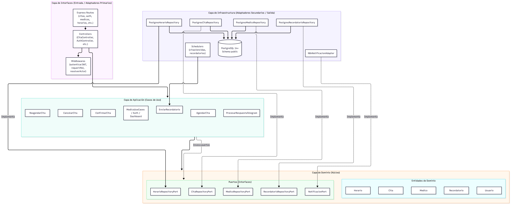

## Estructura de capas y organización del código

### 1. Capa de Dominio (`src/domain/`)

Núcleo del sistema sin dependencias externas:
* **Entidades (`src/domain/entities/`):** `Cita.js` (invariantes de duración y estados), `Horario.js`, `Medico.js`, `Usuario.js` y `Recordatorio.js`.
* **Puertos (`src/domain/ports/`):** Interfaces que declaran contratos de persistencia y comunicación: `CitaRepositoryPort.js`, `HorarioRepositoryPort.js`, `MedicoRepositoryPort.js`, `RecordatorioRepositoryPort.js` y `NotificacionPort.js`.

### 2. Capa de Aplicación (`src/application/`)

Orquesta los flujos de interacción a través de casos de uso (`src/application/use-cases/`):
* `AgendarCita.js`, `ConfirmarCita.js`, `CancelarCita.js`, `ReagendarCita.js`.
* `EnviarRecordatorio.js` y `ProcesarRespuestaTelegram.js`.
* `AprobarUsuario.js`, `RechazarUsuario.js`, `ObtenerResumenAdmin.js`, `ObtenerResumenMedico.js` y `ObtenerResumenPaciente.js`.

### 3. Capa de Infraestructura (`src/infrastructure/`)

Implementa tecnológicamente los puertos declarados en el dominio:
* **Adaptadores de persistencia:** `PostgresCitaRepository.js`, `PostgresHorarioRepository.js`, `PostgresMedicoRepository.js` y `PostgresRecordatorioRepository.js`.
* **Adaptador de notificación:** `N8nNotificacionAdapter.js` (despacha peticiones HTTP hacia n8n).
* **Jobs en segundo plano:** `recordatorioScheduler.js` (evalúa ventanas de 24h y 2h) y `citasVencidasScheduler.js`.

### 4. Capa de Interfaces (`src/interfaces/`)

Puntos de contacto externos vía API REST Express:
* **Rutas y controladores:** Enrutadores en `src/interfaces/http/routes/` y controladores en `src/interfaces/http/controllers/` (`CitaController.js`, `AuthController.js`, etc.).
* **Middlewares:** `autenticarJWT.js` (firma y vigencia de token), `requerirRol.js` (RBAC) y `resolverActor.js` (inyección de contexto en transacciones de auditoría).

## Flujo integral de una petición: "Agendar Cita Médica"

La Figura 2 ilustra el ciclo completo de una solicitud de reserva desde el cliente web hasta su persistencia en PostgreSQL.

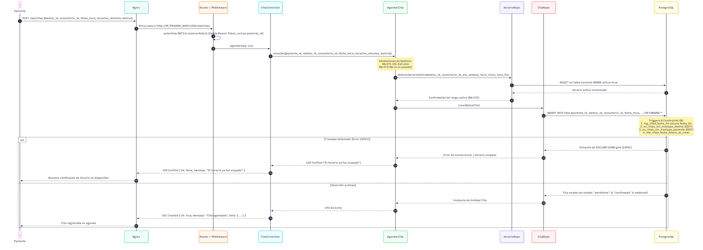

1. **Petición HTTP:** El paciente envía `POST /api/citas` desde React hacia Nginx con su token JWT.
2. **Intermediación y seguridad:** Nginx reenvía al backend (puerto 4000); los middlewares `autenticarJWT` y `resolverActor` validan la identidad del paciente.
3. **Controlador y Caso de Uso:** `CitaController` delega a `AgendarCita.js`, el cual verifica que la duración esté entre 10 y 240 min (RN-071), que la fecha sea futura (RN-073) y consulta a `HorarioRepositoryPort` para asegurar que el bloque esté activo (RN-072).
4. **Persistencia e integridad:** `PostgresCitaRepository` abre una transacción e inserta en `citas`. El trigger `trg_citas_fecha_fin` calcula el término de la cita y el motor evalúa las restricciones GiST (`ex_citas_sin_traslape_medico` y `ex_citas_sin_traslape_paciente`).
5. **Respuesta:** Si hay colisión concurrente (error 23P01), se responde HTTP 409 ("El horario ya fue ocupado"). Si es exitosa, se responde HTTP 201 Created con el DTO consolidado.


\newpage


# Tecnologías utilizadas

El sistema MediCitas utiliza una arquitectura desacoplada basada en tecnologías modernas que garantizan rendimiento, integridad relacional y modularidad. En la Tabla 13 y la Tabla 14 se detallan las versiones exactas verificadas en los archivos de configuración.

## Pila tecnológica del backend

El servidor opera sobre **Node.js 22 LTS** con el framework **Express 5**, utilizando el cliente nativo de PostgreSQL (`pg`) con consultas SQL directas optimizadas para control transaccional estricto.

Tabla 13. Tecnologías y bibliotecas del backend.

| Tecnología / Paquete | Versión declarada | Propósito y justificación en el sistema |
|---|---|---|
| **Node.js** | v22.x LTS | Entorno de ejecución en servidor para JavaScript de alto rendimiento. |
| **Express** | `^5.2.1` | Marco web minimalista para la exposición y enrutamiento de la API REST. |
| **pg** (*node-postgres*) | `^8.23.1` | Controlador de conexión directa y cliente de agrupación (*pooling*) a PostgreSQL. |
| **bcryptjs** | `^3.0.3` | Implementación pura de bcrypt para hashing y contraste seguro de contraseñas. |
| **jsonwebtoken** | `^9.0.3` | Generación, firmado criptográfico y validación de tokens de sesión JWT. |
| **svg-captcha** | `^1.4.0` | Generador de captchas visuales en formato vectorial SVG para protección contra bots. |
| **multer** | `^2.4.0` | Middleware para gestión de solicitudes multipart/form-data y subida de imágenes. |
| **dotenv** | `^18.0.5` | Carga segura de variables de entorno desde archivos locales hacia `process.env`. |
| **cors** | `^2.8.6` | Configuración de políticas de intercambio de recursos de origen cruzado (CORS). |
| **esbuild** | `^0.25.0` | Empaquetador ultrarrápido para generar el bundle único de producción `dist/server.js`. |
| **nodemon** | `^3.1.14` | Monitorización y reinicio automático del servidor en entorno de desarrollo. |
| **node-pg-migrate**| `^9.0.0` | Herramienta de gestión estructurada de migraciones de esquemas en PostgreSQL. |

## Pila tecnológica del frontend

La interfaz web es una aplicación de página única (*SPA*) construida con **React 19** y compilada con **Vite 8**, complementada con bibliotecas especializadas para gráficos analíticos y calendario médico.

Tabla 14. Tecnologías y bibliotecas del frontend.

| Tecnología / Paquete | Versión declarada | Propósito y justificación en el sistema |
|---|---|---|
| **React** | `^19.2.8` | Biblioteca declarativa para la construcción de interfaces de usuario basadas en componentes. |
| **React DOM** | `^19.2.8` | Adaptador del núcleo de React para renderizado eficiente en el DOM del navegador. |
| **React Router DOM** | `^7.18.4` | Enrutador declarativo para navegación cliente y protección de rutas privadas por rol. |
| **Vite** | `^8.3.0` | Entorno de desarrollo rápido y empaquetador de módulos optimizado para producción. |
| **Recharts** | `^3.10.1` | Biblioteca de gráficos analíticos componibles basados en SVG para los tableros analíticos. |
| **@fullcalendar/react** | `^6.1.22` | Componente de calendario interactivo para la gestión visual de citas de médicos y administradores. |
| **@fullcalendar/daygrid** | `^6.1.22` | Vista mensual y cuadrícula de días para el componente de calendario. |
| **@fullcalendar/timegrid**| `^6.1.22` | Vista semanal y diaria con franjas horarias para la visualización de huecos de atención. |
| **@fortawesome/react-fontawesome** | `^3.5.0` | Integración de iconografía vectorial FontAwesome en componentes React. |
| **oxlint** | `^1.81.0` | Linter estático de código JavaScript/React de alto rendimiento escrito en Rust. |

## Motor de base de datos, automatización y servicios

* **PostgreSQL 14+:** Motor relacional con extensiones `pgcrypto` (`gen_random_uuid()`), `citext` (correos case-insensitive) y `btree_gist` (índices GiST para restricciones `EXCLUDE`).
* **n8n (v2.43.7):** Orquestador de automatizaciones desplegado en Docker que conecta Telegram con la API REST.
* **ngrok:** Túnel seguro que expone el puerto de n8n para la recepción de webhooks de Telegram.
* **PM2:** Administrador de procesos en producción para Node.js configurado en modo fork.
* **Nginx 1.24+:** Servidor web y proxy inverso para despachar la SPA estática y redirigir `/api/` y `/uploads/` al backend.


\newpage


# Módulos del sistema

MediCitas se organiza en dos macro-módulos interconectados: **Gestión Clínica** y **Agenda y Notificaciones**, garantizando la segregación de funciones según el rol de usuario autenticado.

## Módulo 1: Gestión clínica

Centraliza la administración de usuarios, control de accesos, infraestructura física y personal facultativo.

1. **Gestión de usuarios y accesos:** Gobierna el registro público con captcha visual (`Registro.jsx`), autenticación (`Login.jsx`), aprobación y asignación de roles por el administrador (`AdminUsuarios.jsx`), y actualización de perfil (`Perfil.jsx`).
2. **Infraestructura médica (Especialidades y Consultorios):** Administra el catálogo de disciplinas médicas (`AdminEspecialidades.jsx`) y consultorios físicos (`AdminConsultorios.jsx`), con borrado lógico protegido ante citas vigentes.
3. **Ficha y asignación de personal médico:** Permite el registro atómico de médicos (`AdminMedicos.jsx`), vinculando usuario, cédula profesional, especialidades y consultorios autorizados.

En la Tabla 15 se sintetiza la correspondencia entre interfaces, roles y endpoints del módulo.

Tabla 15. Correspondencia de pantallas, roles y endpoints del módulo de Gestión Clínica.

| Pantalla frontend | Roles autorizados | Endpoints de la API REST consumidos |
|---|---|---|
| `Registro` / `Login` | Público | `POST /api/auth/registrar`, `POST /api/auth/login`, `GET /api/captcha` |
| `AdminUsuarios` | Administrador | `GET /api/usuarios`, `PUT /api/usuarios/:id/aprobar`, `DELETE /api/usuarios/:id` |
| `AdminEspecialidades` | Administrador | `GET /api/especialidades`, `POST /api/especialidades`, `PATCH /api/especialidades/:id/estado` |
| `AdminConsultorios` | Administrador | `GET /api/consultorios`, `POST /api/consultorios`, `DELETE /api/consultorios/:id` |
| `AdminMedicos` | Administrador | `GET /api/medicos`, `POST /api/medicos`, `PUT /api/medicos/:id/especialidades` |
| `Perfil` | Todos | `GET /api/perfil`, `PUT /api/perfil`, `POST /api/perfil/foto` |

---

## Módulo 2: Agenda y notificaciones

Administra la oferta de disponibilidad semanal, agendamiento de citas, control asistencial y la integración con Telegram.

1. **Horarios de atención:** Permite a médicos y administradores configurar bloques semanales de disponibilidad recurrente (`AdminHorarios.jsx`, `MisHorarios.jsx`) con validación de traslapes en base de datos.
2. **Agendamiento y gestión de citas:** Asistente guiado para pacientes con cálculo dinámico de huecos libres (`AgendarCita.jsx`), gestión de reservas del paciente (`MisCitas.jsx`), agenda del médico con registro de asistencia y notas (`MiAgenda.jsx`), y calendario institucional con FullCalendar (`AdminCalendario.jsx`).
3. **Notificaciones y vinculación con Telegram:** Generación de códigos efímeros de 6 caracteres para enlazar la cuenta del paciente (`VincularTelegram.jsx`), despacho de recordatorios preventivos y recepción de respuestas conversacionales vía webhook.

En la Tabla 16 se presenta la correspondencia operativa del módulo.

Tabla 16. Correspondencia de pantallas, roles y endpoints del módulo de Agenda y Notificaciones.

| Pantalla frontend | Roles autorizados | Endpoints de la API REST consumidos |
|---|---|---|
| `MisHorarios` / `AdminHorarios` | Médico, Admin | `GET /api/horarios`, `POST /api/horarios`, `DELETE /api/horarios/:id` |
| `AgendarCita` | Paciente, Admin | `GET /api/especialidades`, `GET /api/medicos`, `GET /api/horarios/medico/:id`, `POST /api/citas` |
| `MisCitas` | Paciente | `GET /api/citas`, `PUT /api/citas/:id/confirmar`, `GET /api/citas/:id/propuestas`, `PUT /api/citas/:id` |
| `MiAgenda` | Médico | `GET /api/citas`, `PUT /api/citas/:id/estado`, `GET /api/citas/mis-pacientes` |
| `AdminCitas` / `AdminCalendario` | Administrador | `GET /api/citas`, `PUT /api/citas/:id/estado`, `GET /api/citas/:id/historial` |
| `VincularTelegram` | Paciente | `POST /api/telegram/codigo`, `GET /api/telegram/estado`, `DELETE /api/telegram/vincular` |


\newpage


# Base de datos

La capa de datos se implementó sobre **PostgreSQL 14+**, delegando la aplicación de restricciones de concurrencia y auditoría directamente al motor relacional para asegurar la consistencia transaccional.

## Modelo entidad-relación (ERD)

El esquema consta de 15 tablas divididas entre catálogos normalizados (`roles`, `estados_cuenta`, `estados_cita`, `especialidades`), entidades maestras (`usuarios`, `pacientes`, `medicos`, `consultorios`), tablas de enlace N:M (`medico_especialidades`, `medico_consultorios`) y tablas transaccionales (`horarios`, `citas`, `historial_estados_cita`, `recordatorios`, `telegram_codigos`).

La Figura 3 detalla las relaciones y tipos de datos del esquema.


## Restricciones avanzadas de integridad

### Restricciones CHECK

* `chk_horarios_dia_semana`: Garantiza `dia_semana BETWEEN 1 AND 7` (norma ISO 8601).
* `chk_horarios_rango`: Exige `hora_fin > hora_inicio`.
* `chk_citas_duracion`: Acota la consulta con `duracion_minutos BETWEEN 10 AND 240`.
* `chk_citas_fecha_futura_al_crear`: Impide citas en el pasado con `fecha_hora > created_at - INTERVAL '1 minute'`.
* `chk_pacientes_fecha_nacimiento`: Exige `fecha_nacimiento IS NULL OR fecha_nacimiento <= CURRENT_DATE`.

### Restricciones de exclusión (EXCLUDE USING gist)

Para evitar condiciones de carrera sin bloqueos distribuidos, se utilizan índices GiST con la extensión `btree_gist`:

1. **Horarios de médico sin traslape (`horarios`):**
   ```sql
   CONSTRAINT ex_horarios_sin_traslape
     EXCLUDE USING gist (medico_id WITH =, dia_semana WITH =, timerange(hora_inicio, hora_fin) WITH &&)
     WHERE (activo);
   ```
2. **Citas de médico sin traslape (`citas`):**
   ```sql
   CONSTRAINT ex_citas_sin_traslape_medico
     EXCLUDE USING gist (medico_id WITH =, tstzrange(fecha_hora, fecha_fin) WITH &&)
     WHERE (estado_id IN (1, 2, 3));
   ```
3. **Citas de paciente sin traslape (`citas`, migración 006):**
   ```sql
   CONSTRAINT ex_citas_sin_traslape_paciente
     EXCLUDE USING gist (paciente_id WITH =, tstzrange(fecha_hora, fecha_fin) WITH &&)
     WHERE (estado_id IN (1, 2, 3));
   ```

## Disparadores (Triggers) y procedimientos almacenados

1. **Actualización de `updated_at`:** La función `set_updated_at()` se dispara `BEFORE UPDATE` en tablas maestras asignando `now()`.
2. **Cálculo de fin de cita (`calcular_fecha_fin_cita`):** Trigger `BEFORE INSERT OR UPDATE ON citas` que calcula `fecha_fin := fecha_hora + (duracion_minutos * interval '1 minute')` para habilitar el índice GiST inmutable.
3. **Auditoría inmutable (`registrar_cambio_estado_cita`):** Trigger `AFTER UPDATE ON citas` (migración 007) que lee variables de sesión (`app.cambiado_por`, `app.origen`, `app.comentario`) e inserta en `historial_estados_cita`.
4. **Blindaje de auditoría (`impedir_modificacion_historial`):** Trigger `BEFORE UPDATE OR DELETE ON historial_estados_cita` que aborta cualquier intento de alteración (RN-092).

## Vistas de conveniencia y borrado lógico

* **Vista `vw_citas_detalle`:** Centraliza las uniones entre citas, pacientes, médicos, consultorios y estados para simplificar las consultas analíticas de los dashboards.
* **Borrado Lógico (*Soft Delete*):** Las entidades `usuarios`, `pacientes`, `medicos` y `consultorios` usan `deleted_at`. La unicidad de correos y cédulas se preserva mediante índices únicos parciales:
  * `CREATE UNIQUE INDEX ux_usuarios_email_activo ON usuarios (email) WHERE deleted_at IS NULL;`
  * `CREATE UNIQUE INDEX ux_medicos_cedula_activa ON medicos (cedula_profesional) WHERE deleted_at IS NULL;`

## Uso de funciones SQL nativas en repositorios

La Tabla 17 detalla las funciones avanzadas de PostgreSQL implementadas en el código fuente para delegar el procesamiento analítico al motor.

Tabla 17. Uso de funciones SQL avanzadas en el código del repositorio.

| Función SQL utilizada | Archivo fuente en el repositorio | Líneas | Justificación técnica y resultado |
|---|---|---|---|
| `date_trunc('month', now())` | `backend/src/infrastructure/adapters/PostgresDashboardRepository.js` | 45-46, 112-113 | Trunca marcas de tiempo al primer día del mes para métricas mensuales. |
| `to_char(d.dia, 'YYYY-MM-DD')` / `to_char(..., 'TMDD "de" TMMonth')` | `backend/src/infrastructure/adapters/PostgresDashboardRepository.js` | 95-96, 118-119, 216-217 | Genera etiquetas de fecha legibles en español para gráficos Recharts. |
| `c.fecha_hora AT TIME ZONE $3` | `backend/src/infrastructure/adapters/PostgresDashboardRepository.js` | 236, 243, 258, 278 | Convierte marcas UTC al huso local (`America/Mexico_City`) previo a agrupar. |
| `EXTRACT(HOUR FROM ...)` | `backend/src/infrastructure/adapters/PostgresDashboardRepository.js` | 245, 260, 273-274 | Clasifica consultas en turnos matutinos y vespertinos. |
| `ROUND(100.0 * x / NULLIF(total, 0), 1)` | `backend/src/infrastructure/adapters/PostgresDashboardRepository.js` | 311, 315 | Calcula porcentajes a un decimal evitando división entre cero con `NULLIF`. |
| `TRUNC(minutos / 60.0)`, `MOD(minutos, 60)`, `CONCAT(...)` | `backend/src/infrastructure/adapters/PostgresDashboardRepository.js` | 334-338 | Convierte duración promedio a formato estructurado (ej. "1 h 30 min"). |
| `timerange(hora_inicio, hora_fin) && timerange($3, $4)` | `backend/src/infrastructure/adapters/PostgresHorarioRepository.js` | 152 | Evalúa superposición de rangos de horas directamente en la consulta SQL. |


\newpage


# Automatización con n8n y asistente conversacional

MediCitas integra un subsistema de automatización basado en **n8n (v2.43.7)** que conecta el backend con **Telegram**, ofreciendo un agente conversacional interactivo con modelos de lenguaje y el despacho automatizado de recordatorios preventivos.

La Figura 4 detalla la secuencia entre el planificador de recordatorios, n8n, Telegram y el paciente.

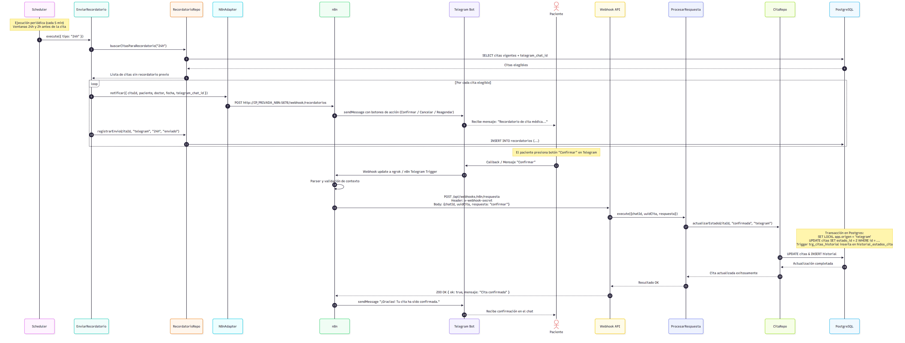

## Arquitectura del flujo de trabajo (`MediCitas.json`)

El flujo reside en `MediCitas.json` (ID: `GLIxoBsZqn5Tb9bT`) y consta de **31 nodos interconectados**.

### 1. Disparadores (*Triggers*)

* **Telegram Trigger (`Entrada`):** Recibe mensajes y comandos dirigidos a `@medicitasAppBot` vía el túnel HTTPS de ngrok.
* **Webhook (`Webhook`):** Expone `/webhook/recordatorios` en el puerto 5678, consumido internamente por el scheduler de backend.

### 2. Vinculación y autenticación de pacientes

1. **Filtro (`Solo texto`):** Descarta mensajes binarios no procesables.
2. **Evaluación de sesión (`Obtener token`):** Invoca `POST /api/telegram/sesion` con el `chatId`. Si la cuenta está enlazada y activa, emite un JWT válido por 24 horas.
3. **Bifurcación (`Codigo sin vincular?`):** Si el mensaje contiene `/start <CODIGO>` (código de 6 caracteres generado en la webapp, RN-116), el nodo `Vincular cuenta` ejecuta `POST /api/telegram/vincular` con `x-webhook-secret` y confirma el enlace al paciente.

### 3. Agente de IA y herramientas HTTP

El nodo **AI Agent** opera como un agente conversacional con memoria temporal (`Simple Memory`) respaldado por **Groq Chat Model** (Llama 3 / Mixtral) y **Google Gemini Chat Model**. Dispone de **13 herramientas HTTP** conectadas a la API REST, detalladas en la Tabla 18.

Tabla 18. Herramientas HTTP expuestas al agente conversacional en n8n.

| Nombre de la herramienta | Endpoint backend asociado | Método HTTP | Acción ejecutada |
|---|---|:---:|---|
| `list_specialties` | `/api/especialidades` | GET | Consulta de disciplinas médicas activas. |
| `search_doctors` | `/api/medicos` | GET | Búsqueda de facultativos y sus sedes. |
| `get_available_slots`| `/api/horarios/medico/:id` | GET | Cálculo dinámico de huecos libres por fecha. |
| `list_my_appointments` | `/api/citas` | GET | Listado de citas del paciente autenticado. |
| `get_appointment` | `/api/citas/:id` | GET | Detalle específico de una consulta. |
| `get_appointment_history` | `/api/citas/:id/historial` | GET | Auditoría de estados de la cita (RN-090). |
| `create_appointment` | `/api/citas` | POST | Reserva de cita (creada como `confirmada`). |
| `confirm_appointment`| `/api/citas/:id/confirmar` | PUT | Confirmación explícita de asistencia. |
| `cancel_appointment` | `/api/citas/:id` | DELETE | Cancelación y liberación de horario (RN-085). |
| `get_reschedule_options` | `/api/citas/:id/propuestas` | GET | Propuesta de 3 huecos más cercanos (RN-083). |
| `reschedule_appointment` | `/api/citas/:id` | PUT | Reprogramación efectiva de cita (RN-084). |

## Ciclo de vida de los recordatorios

1. **Detección programada:** Cada 5 minutos, `recordatorioScheduler.js` busca citas vigentes en ventanas de 24h (RN-100) y 2h (RN-101) con Telegram enlazado.
2. **Despacho a n8n:** El adaptador `N8nNotificacionAdapter` envía la carga JSON al webhook de n8n.
3. **Envío con botones interactivos:** El nodo `Send a text message` transmite a Telegram los datos de la cita y botones en línea: "Confirmar", "Cancelar" y "Reagendar".
4. **Respuesta del paciente:** Al presionar un botón, n8n transmite la acción a `POST /api/webhooks/n8n/respuesta`. El caso de uso `ProcesarRespuestaTelegram` actualiza la cita, registra auditoría inmutable e instruye la confirmación al chat.


\newpage


# Infraestructura en Amazon Web Services (AWS)

MediCitas se desplegó en **Amazon Web Services (AWS)** en la región `us-east-1` utilizando cuatro instancias **Amazon EC2** aisladas por responsabilidad y protegidas por Grupos de Seguridad bajo el principio de mínimo privilegio.

La Figura 5 detalla la topología de red, instancias, puertos y flujos de tráfico autorizados.

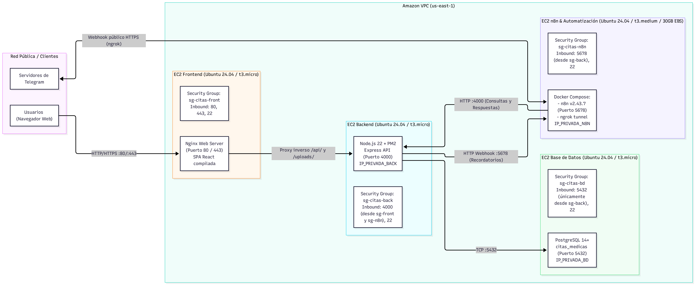

## Justificación de la arquitectura de 4 instancias frente a 2

El Taller 3 contemplaba inicialmente dos instancias virtuales. Para MediCitas se implementaron **cuatro instancias dedicadas** por las siguientes razones:

1. **Aislamiento de n8n y Docker:** n8n y ngrok demandan recursos computacionales significativos y un volumen de 30 GB EBS para dependencias y bitácoras; su aislamiento previene degradaciones sobre la API transaccional.
2. **Defensa en profundidad para PostgreSQL:** La instancia `EC2-BD` no se expone a Internet; su puerto 5432 solo admite conexiones TCP procedentes de la IP privada de `EC2-BACK`.
3. **Desacoplamiento web y aplicativo:** Separar Nginx (`EC2-FRONT`) de Node.js (`EC2-BACK`) permite la entrega eficiente de activos estáticos y terminación TLS sin competir por CPU con el procesamiento de peticiones.
4. **Independencia de despliegues:** El uso de cuatro ramas huérfanas compiladas (`deploy/db`, `deploy/back`, `deploy/front`, `deploy/n8n`) permite actualizar cada capa sin reiniciar componentes no afectados.

## Características de las instancias EC2

En la Tabla 19 se desglosan las especificaciones de las instancias aprovisionadas.

Tabla 19. Especificaciones de las instancias Amazon EC2 desplegadas en AWS.

| Identificador lógico | Tipo de instancia | Sistema Operativo | Almacenamiento EBS | Software principal alojado |
|---|---|---|---|---|
| **EC2-FRONT** | `t3.micro` | Ubuntu 24.04 LTS | 8 GB gp3 | Nginx 1.24+, SPA React compilada en `/var/www/app` |
| **EC2-BACK** | `t3.micro` | Ubuntu 24.04 LTS | 8 GB gp3 | Node.js 22 LTS, PM2, API Express en puerto 4000 |
| **EC2-BD** | `t3.micro` | Ubuntu 24.04 LTS | 8 GB gp3 | PostgreSQL 14+, extensiones pgcrypto, citext, btree_gist |
| **EC2-N8N** | `t3.medium` | Ubuntu 24.04 LTS | 30 GB gp3 | Docker, n8n v2.43.7, túnel ngrok, puerto 5678 |

## Grupos de Seguridad (Security Groups)

La Tabla 20 resume las reglas de entrada implementadas para restringir accesos por capas.

Tabla 20. Configuración de Grupos de Seguridad en AWS.

| Security Group | Puerto / Protocolo | Origen permitido | Propósito y justificación |
|---|---|---|---|
| `sg-citas-front` | 80 / TCP (HTTP) | `0.0.0.0/0` | Tráfico web público de pacientes y administradores. |
| `sg-citas-front` | 443 / TCP (HTTPS)| `0.0.0.0/0` | Tráfico web seguro cifrado con TLS/SSL. |
| `sg-citas-front` | 22 / TCP (SSH) | IP del administrador | Acceso administrativo a terminal mediante clave privada. |
| `sg-citas-back` | 4000 / TCP | `sg-citas-front` | Peticiones API originadas desde el proxy Nginx. |
| `sg-citas-back` | 4000 / TCP | `sg-citas-n8n` | Herramientas HTTP ejecutadas por el agente de n8n. |
| `sg-citas-back` | 22 / TCP (SSH) | IP del administrador | Gestión remota de la instancia. |
| `sg-citas-bd` | 5432 / TCP | `sg-citas-back` | Conexiones de base de datos exclusivas desde la API backend. |
| `sg-citas-bd` | 22 / TCP (SSH) | IP del administrador | Gestión remota y ejecución de migraciones. |
| `sg-citas-n8n` | 5678 / TCP | `sg-citas-back` | Disparo del webhook interno de recordatorios de citas. |
| `sg-citas-n8n` | 22 / TCP (SSH) | IP del administrador | Gestión del demonio Docker y actualización de flujos. |

## Ramas de despliegue huérfanas (*Orphan Branches*)

El script `deploy/build-y-publicar.sh` compila en local y publica cuatro ramas desvinculadas del historial de desarrollo:
* `deploy/db`: Contiene migraciones SQL y `deploy/deploy-db.sh`.
* `deploy/back`: Contiene el bundle `dist/server.js`, `package.json` de producción y `deploy/deploy-back.sh`.
* `deploy/front`: Contiene activos compilados en `dist/`, plantilla de Nginx y `deploy/deploy-front.sh`.
* `deploy/n8n`: Contiene `docker-compose.yml`, `MediCitas.json` y `deploy/deploy-n8n.sh`.


\newpage


# Despliegue paso a paso en AWS

El despliegue de MediCitas se automatizó en dos fases: compilación y publicación de ramas huérfanas desde el entorno local, y aprovisionamiento secuencial desatendido en las cuatro instancias EC2.

La Figura 6 esquematiza el flujo continuo de compilación y entrega por ramas.


## Fase 1: Compilación y publicación (`build-y-publicar.sh`)

1. **Clonación limpia en `/tmp`:** Para evitar bloqueos de archivos en sistemas DrvFs (WSL), el script clona el repositorio en un directorio ext4 nativo.
2. **Empaquetado de Backend:** Ejecuta `esbuild src/server.js --bundle --platform=node --target=node22 --packages=external --outfile=dist/server.js`.
3. **Compilación de Frontend:** Genera los activos estáticos minificados en `frontend/dist/` mediante `npm run build`.
4. **Publicación por ramas huérfanas:** Crea las ramas `deploy/db`, `deploy/back`, `deploy/front` y `deploy/n8n`, enviándolas con `git push -f origin <rama>`.

## Fase 2: Orden secuencial de despliegue en AWS

### Paso 1: Base de Datos (`EC2-BD`)

Descarga la rama `deploy/db` y aprovisiona PostgreSQL:

```bash
git clone -b deploy/db https://github.com/REPO_USUARIO/citas-medicas.git app && cd app
DB_PASSWORD='SECRETO_DB' ADMIN_PASSWORD='SECRETO_ADMIN' CARGAR_DEMO=1 bash deploy/deploy-db.sh
```

El script configura `postgresql.conf` (`listen_addresses='*'`), autoriza la subred en `pg_hba.conf`, habilita las extensiones `pgcrypto`, `citext`, `btree_gist`, corre las 8 migraciones, crea el admin inicial y concede permisos completos a `citas_user`.

### Paso 2: Motor de automatización (`EC2-N8N`)

Descarga la rama `deploy/n8n` y lanza los contenedores:

```bash
git clone -b deploy/n8n https://github.com/REPO_USUARIO/citas-medicas.git app && cd app
export N8N_ENCRYPTION_KEY='CLAVE' N8N_WEBHOOK_SECRET='SECRETO' TELEGRAM_BOT_TOKEN='TOKEN' GROQ_API_KEY='KEY' NGROK_AUTHTOKEN='TOKEN'
bash deploy/deploy-n8n.sh IP_PRIVADA_BACK
```

Instala Docker, levanta n8n (v2.43.7) y ngrok, importa credenciales, carga `MediCitas.json` y activa el flujo mediante `n8n publish:workflow --id=GLIxoBsZqn5Tb9bT --active=true`.

### Paso 3: Backend API (`EC2-BACK`)

Descarga la rama `deploy/back` e inicia la aplicación supervisada por PM2:

```bash
git clone -b deploy/back https://github.com/REPO_USUARIO/citas-medicas.git app && cd app
export DB_PASSWORD='SECRETO_DB' JWT_SECRET='SECRETO_JWT' N8N_WEBHOOK_SECRET='SECRETO'
bash deploy/deploy-back.sh IP_PRIVADA_BD IP_PRIVADA_N8N
```

Instala Node.js 22 LTS, PM2, dependencias de producción (`npm install --omit=dev`), crea carpetas de uploads, genera `.env` con `TZ=America/Mexico_City`, arranca `dist/server.js` con PM2 y valida `/api/health`.

### Paso 4: Frontend Web (`EC2-FRONT`)

Descarga la rama `deploy/front` y configura Nginx:

```bash
git clone -b deploy/front https://github.com/REPO_USUARIO/citas-medicas.git app && cd app
bash deploy/deploy-front.sh IP_PRIVADA_BACK
```

Instala Nginx, copia los archivos estáticos a `/var/www/app`, sustituye `__BACKEND_IP__` en la configuración del proxy inverso, valida la sintaxis con `nginx -t` y reinicia el servicio.


\newpage


# Pruebas automatizadas del sistema

La validación del comportamiento funcional y de la integridad de las reglas de negocio del sistema MediCitas se diseñó a través de una suite de pruebas de integración automatizadas basadas en scripts de shell (`bash`), herramientas estándar de red (`curl`) y procesadores de estructuras JSON (`jq`). Todos los scripts residen en el directorio `backend/tests/` y operan directamente sobre los endpoints de la API REST, simulando las peticiones reales de clientes HTTP.

## Suite de pruebas de integración

La batería de pruebas se compone de diez scripts especializados organizados por dominio funcional, orquestados mediante un script global. En la Tabla 21 se desglosa el alcance y cobertura de cada script.

Tabla 21. Batería de pruebas automatizadas del backend.

| Archivo de prueba | Casos cubiertos y validaciones de negocio |
|---|---|
| `correr-todo.sh` | Orquestador general. Ejecuta secuencialmente todos los scripts de prueba `probar-*.sh`, recopila los conteos de pruebas aprobadas y fallidas, y genera un reporte consolidado con código de salida estandarizado. |
| `probar-usuarios.sh` | Creación de usuarios con roles válidos, bloqueo de inicio de sesión en cuentas pendientes, aprobación de cuentas por el administrador, rechazo de solicitudes, restricciones de asignación de rol médico por vía genérica y borrado lógico. |
| `probar-especialidades.sh`| Alta de especialidades médicas, control de unicidad de nombre (RN-030), modificación de descripción, activación e inactivación lógica (RN-031) y filtrado de especialidades disponibles. |
| `probar-consultorios.sh` | CRUD de sedes físicas, validación de campos obligatorios (nombre y dirección), borrado lógico (RN-033) y rechazo con código HTTP 409 ante intentos de eliminación de consultorios con citas vigentes. |
| `probar-medicos.sh` | Registro transaccional atómico de médico con usuario y relaciones (RN-042), unicidad de cédula profesional (RN-041), reemplazo completo de especialidades y consultorios, ocultamiento de datos confidenciales ante pacientes (RN-046) y baja lógica en cascada (RN-045). |
| `probar-pacientes.sh` | Creación de ficha de paciente, validación de aislamiento de datos privados (un paciente solo puede consultar su propio registro, retornando 403 ante accesos no autorizados segun RN-053) y baja lógica de cuenta. |
| `probar-integracion.sh` | Flujo integral de punta a punta: cálculo de huecos libres, agendamiento de cita en estado pendiente, confirmación de cita, intento de doble agendamiento en el mismo horario (validación del error 409 por restricción `EXCLUDE USING gist`) y transiciones de estado permitidas. |
| `probar-reagendar.sh` | Consulta algorítmica de los 3 huecos libres más cercanos para una cita vigente (RN-083), validación de anticipación mínima (RN-086), ejecución del reagendamiento con revalidación de traslapes (RN-084) y verificación de auditoría inmutable. |
| `probar-telegram.sh` | Generación de código efímero de vinculación de 6 caracteres con 15 minutos de TTL (RN-116), canje autenticado con `x-webhook-secret`, verificación de idempotencia, emisión de tokens JWT para el bot y procesamiento de respuestas de recordatorios. |
| `probar-dashboard.sh` | Consulta y consistencia de los resúmenes analíticos para administrador, médico y paciente; verificación de ausencia total de fugas de contraseñas (`password_hash`), validación de filtros de rangos de fechas y cálculo de porcentajes sin divisiones por cero. |


\newpage


# Evidencias de funcionamiento y despliegue

A continuación se presenta el catálogo de evidencias que certifican la implementación, operatividad y despliegue del sistema MediCitas en Amazon Web Services (AWS), cubriendo los requerimientos del Taller 3.

---

### Captura 1: Inicio de sesión con validación de Captcha visual

**Qué muestra:** Demuestra la protección contra accesos automatizados mediante captchas SVG efímeros (RN-020 a RN-023).
**Qué observar:** Formulario de credenciales, imagen vectorial del captcha con ruido y campo de verificación.

---

### Captura 2: Tablero analítico del Administrador con indicadores y gráficos
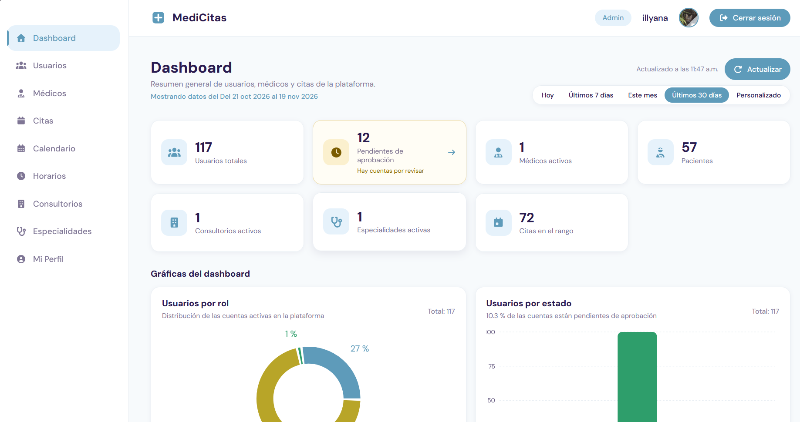
**Qué muestra:** Presenta los indicadores cuantitativos de citas, facultativos y ocupación calculados en PostgreSQL.
**Qué observar:** Tarjetas con conteos consolidados y gráficos cronológicos de distribución de consultas por día y estado.

---

### Captura 3: Administración y aprobación de usuarios
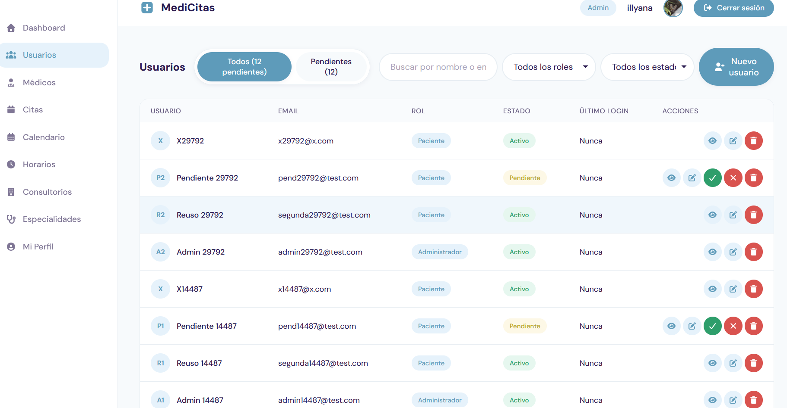
**Qué muestra:** Evidencia la consola para aprobar o rechazar cuentas en estado pendiente y gestionar roles (RN-003 a RN-005).
**Qué observar:** Listado con estados de cuenta y botones contextuales para aprobación, cambio de rol o baja lógica.

---

### Captura 4: Administración del catálogo de especialidades médicas
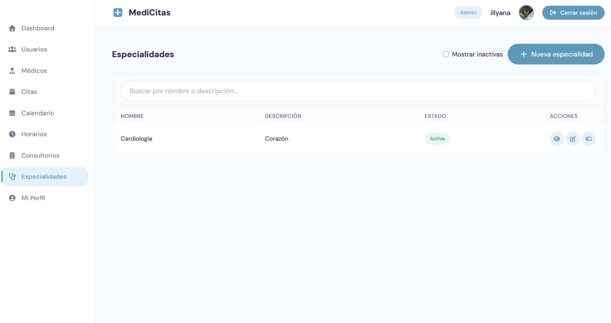
**Qué muestra:** Certifica el mantenimiento de especialidades médicas con nombres únicos y activación lógica (RN-030 a RN-034).
**Qué observar:** Catálogo de disciplinas clínicas, estado activo/inactivo y modal para alta o modificación.

---

### Captura 5: Gestión de consultorios físicos
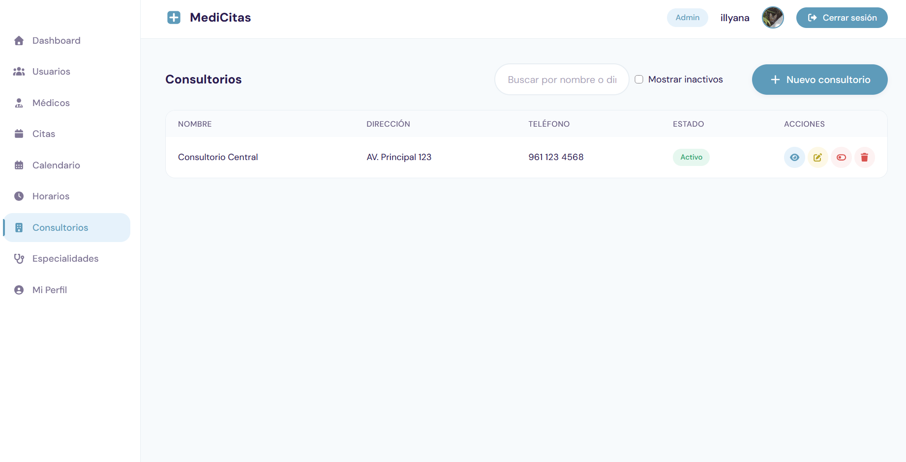
**Qué muestra:** Acredita la gestión de espacios físicos de consulta y su borrado lógico seguro (RN-032 a RN-034).
**Qué observar:** Nombres de consultorios, ubicaciones físicas, teléfonos y opciones de edición o inactivación.

---

### Captura 6: Registro transaccional y catálogo de médicos
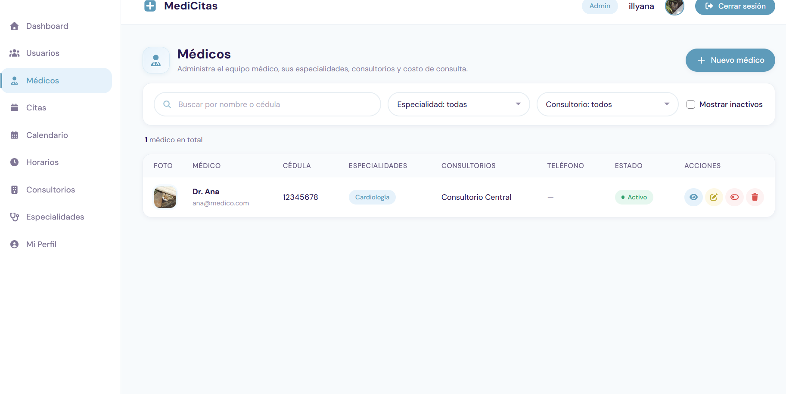
**Qué muestra:** Demuestra el alta atómica de médicos vinculando usuario, cédula, especialidades y consultorios (RN-040 a RN-047).
**Qué observar:** Fichas profesionales con cédula visible para admin, especialidades acreditadas y sedes autorizadas.

---

### Captura 7: Proceso de agendamiento de cita como paciente
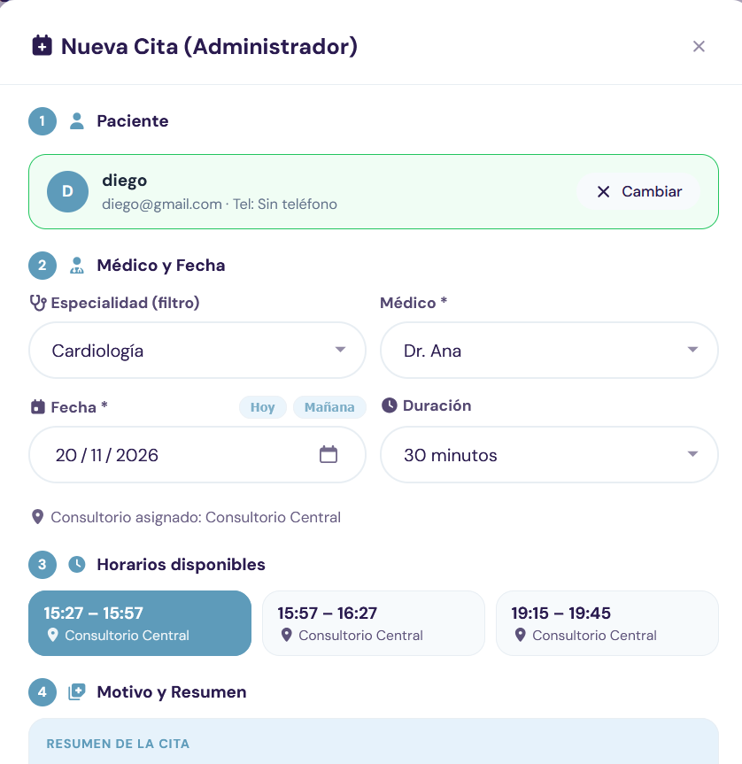
**Qué muestra:** Ilustra la reserva guiada de consultas mediante el cálculo dinámico de huecos libres (RN-065 y RN-070 a RN-073).
**Qué observar:** Selectores de especialidad, facultativo, fecha en calendario y cuadrícula horaria de turnos disponibles.

---

### Captura 8: Detección y rechazo de doble agendamiento (Restricción GiST)
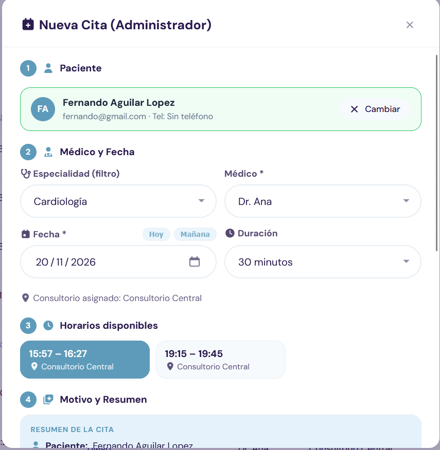
**Qué muestra:** Constata la captura del error 23P01 de PostgreSQL ante colisiones temporales concurrentes (RN-074 y RN-075).
**Qué observar:** Mensaje de error 409 amigable impidiendo la reserva duplicada en el mismo intervalo.

---

### Captura 9: Visualización de citas en agenda y calendario
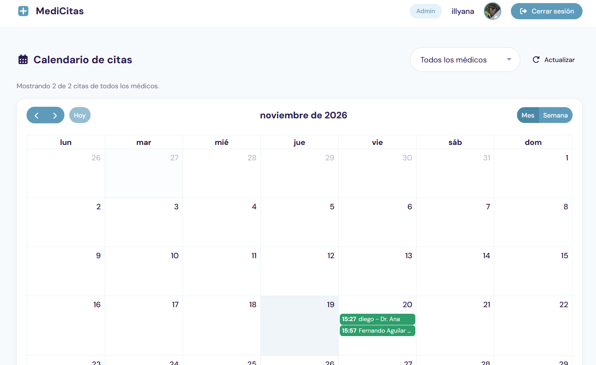
**Qué muestra:** Exhibe la agenda médica en cuadrícula interactiva y el control asistencial por consulta (RN-082).
**Qué observar:** Eventos clasificados por color según estado y opciones para asentar asistencia del paciente.

---

### Captura 10: Flujo de trabajo activo en la interfaz de n8n
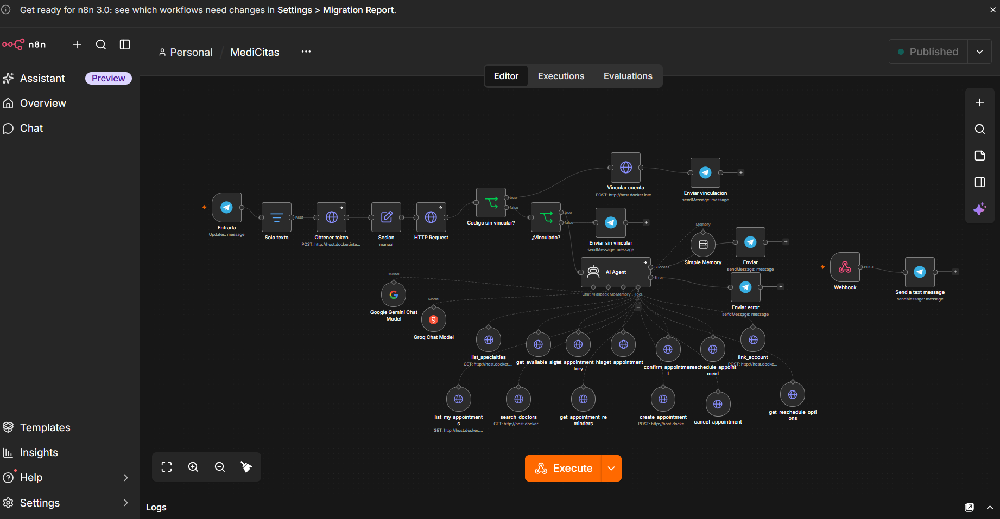
**Qué muestra:** Acredita el flujo integral de automatización con sus dos disparadores, agente IA y 13 herramientas HTTP.
**Qué observar:** Topología completa de nodos conectados y el indicador superior en estado activo.

---

### Captura 11: Conversación interactiva con el bot de Telegram
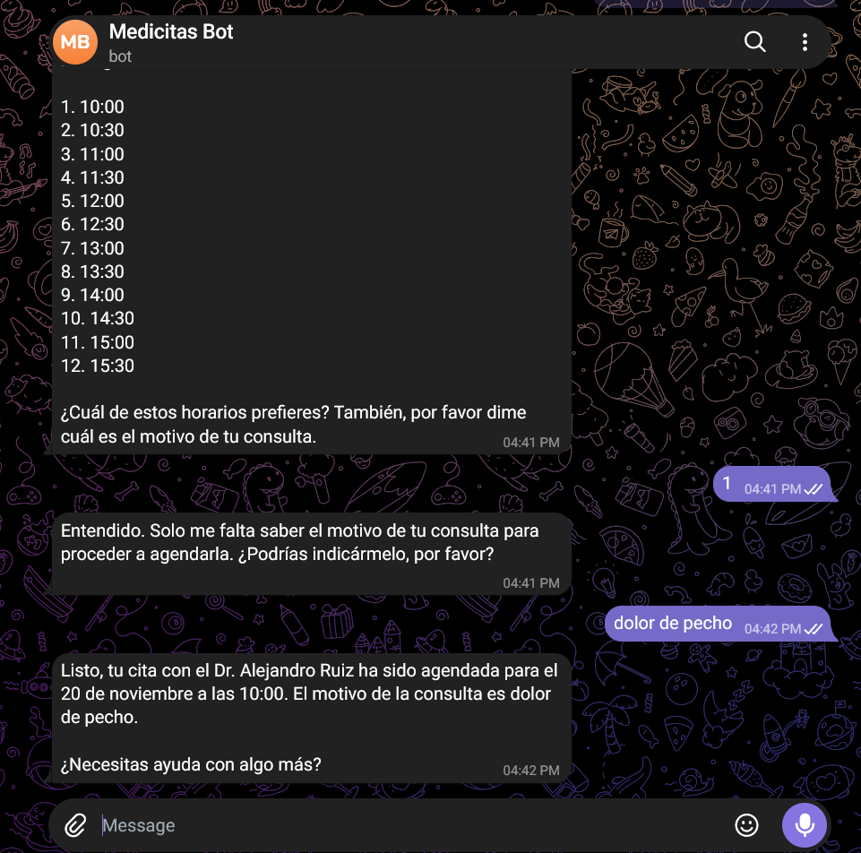
**Qué muestra:** Demuestra la vinculación por comando `/start <codigo>` y la gestión conversacional de citas con IA (RN-116).
**Qué observar:** Mensajes de confirmación de enlace de cuenta y respuestas del bot consultando o reservando citas.

---

### Captura 12: Recordatorio preventivo recibido en Telegram con botones de acción
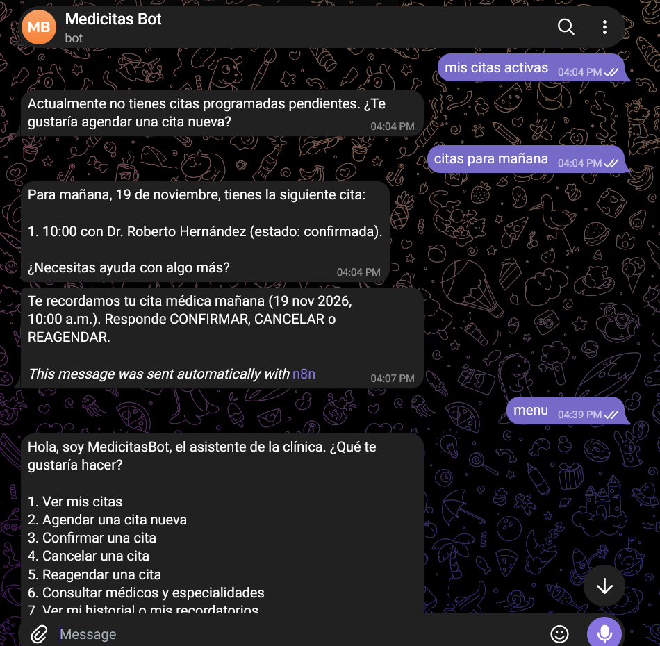
**Qué muestra:** Comprueba el despacho autónomo de alertas preventivas programadas con botones interactivos (RN-100 a RN-104).
**Qué observar:** Detalle de la cita médica y botones "Confirmar", "Cancelar" y "Reagendar" al pie del mensaje.

---

### Captura 13: Panel de instancias Amazon EC2 en la consola de AWS
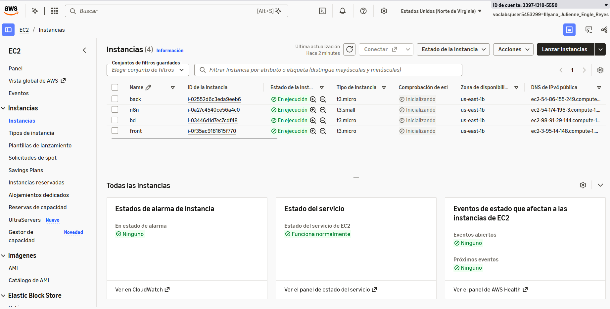
**Qué muestra:** Certifica el despliegue de las cuatro máquinas virtuales aisladas en la infraestructura cloud de AWS.
**Qué observar:** Instancias `EC2-FRONT`, `EC2-BACK`, `EC2-BD` y `EC2-N8N` activas con comprobaciones de estado aprobadas.

---

### Captura 14: Configuración de Grupos de Seguridad (Security Groups) en AWS
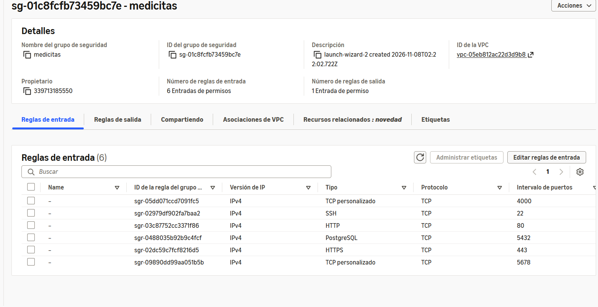
**Qué muestra:** Evidencia la aplicación del principio de mínimo privilegio restringiendo puertos entre capas.
**Qué observar:** Reglas entrantes donde la base de datos y n8n solo reciben tráfico autorizado desde el backend.

---

### Captura 15: Tablas y extensiones en PostgreSQL (Terminal EC2-BD)
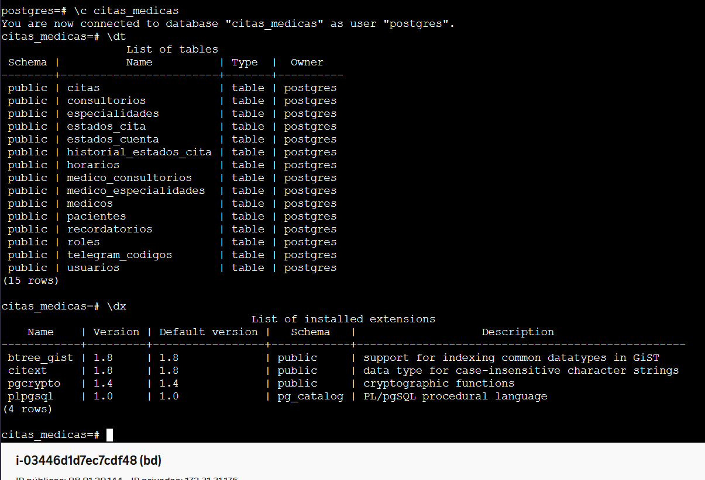
**Qué muestra:** Constata la correcta aplicación de las migraciones creando las 15 tablas y las 3 extensiones nativas.
**Qué observar:** Esquema público con tablas transaccionales y presencia de `pgcrypto`, `citext` y `btree_gist`.

---

### Captura 16: Estado de procesos en PM2 (Terminal EC2-BACK)
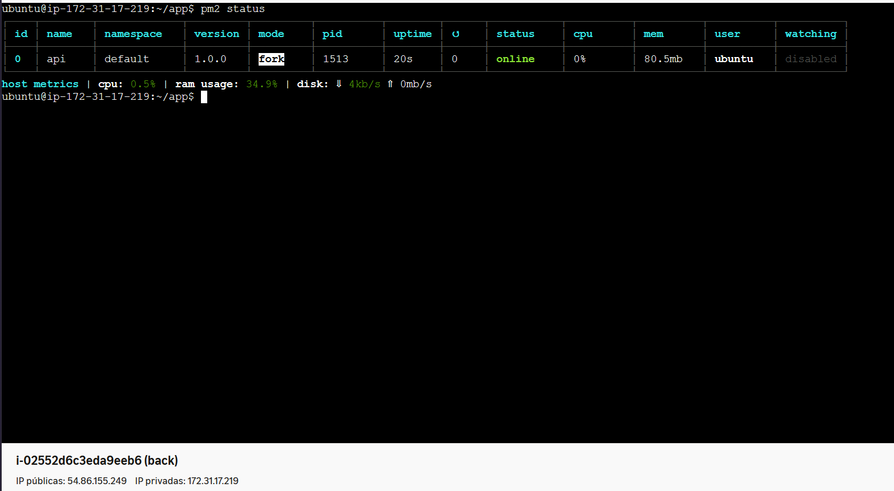
**Qué muestra:** Verifica la ejecución supervisada y estable del servidor backend bajo el gestor PM2.
**Qué observar:** Proceso `api` en modo `fork`, estado `online`, uso controlado de memoria y cero reinicios.

---

### Captura 17: Contenedores Docker activos en EC2-N8N
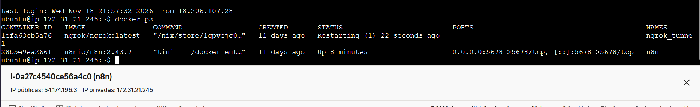
**Qué muestra:** Certifica la ejecución simultánea y saludable de los contenedores de n8n y del túnel ngrok.
**Qué observar:** Contenedores `n8n` (puerto 5678) y `ngrok_tunnel` en estado activo e interconectados.

---

### Captura 18: Verificación sintáctica y estado de Nginx (Terminal EC2-FRONT)
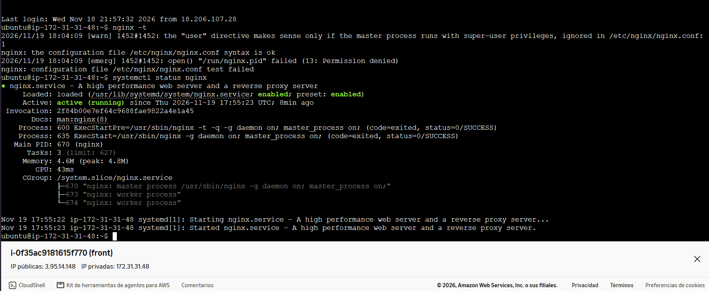
**Qué muestra:** Constata la correcta sintaxis y ejecución del proxy inverso web en la instancia de frontend.
**Qué observar:** Respuesta `syntax is ok` y estado `active (running)` del servicio del servidor web.

---

### Captura 19: Aplicación web operativa en el navegador desde la IP pública
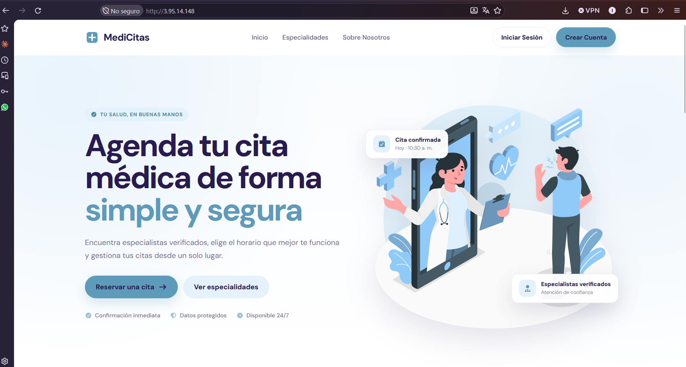
**Qué muestra:** Certifica la entrega pública completa de la solución a usuarios finales a través de Internet.
**Qué observar:** Barra de direcciones con la IP pública del frontend y la interfaz gráfica plenamente operativa.

---

## Matriz y guía para la recolección de evidencias

En la Tabla 23 se resume el catálogo consolidado de evidencias requeridas para el informe técnico.

Tabla 23. Catálogo de evidencias y capturas requeridas para el informe técnico.

| Número | Nombre de archivo sugerido | Descripción de la captura | Prioridad |
|:---:|---|---|:---:|
| 1 | `01-login-captcha.png` | Formulario de login con captcha visual | Alta |
| 2 | `02-dashboard-admin.png` | Dashboard de admin con métricas y gráficas Recharts | Alta |
| 3 | `03-crud-usuarios.png` | Gestión de usuarios y aprobación de cuentas | Media |
| 4 | `04-crud-especialidades.png` | Listado y modal de especialidades médicas | Media |
| 5 | `05-crud-consultorios.png` | Catálogo de consultorios físicos | Media |
| 6 | `06-crud-medicos.png` | Fichas médicas con especialidades y consultorios | Alta |
| 7 | `07-agendar-cita-paciente.png` | Asistente de agendamiento con cálculo de huecos | Alta |
| 8 | `08-rechazo-doble-agendamiento.png` | Mensaje de rechazo 409 por restricción GiST | Crítica |
| 9 | `09-agenda-calendario.png` | Agenda médica o calendario interactivo | Alta |
| 10 | `10-n8n-workflow-activo.png` | Flujo de n8n activo con sus 31 nodos | Crítica |
| 11 | `11-telegram-chatbot.png` | Chat con @medicitasAppBot en Telegram | Alta |
| 12 | `12-telegram-recordatorio.png` | Recordatorio en Telegram con botones interactivos | Alta |
| 13 | `13-aws-consolas-ec2.png` | Consola de AWS con las 4 instancias EC2 activas | Crítica |
| 14 | `14-aws-security-groups.png` | Reglas de entrada de los Security Groups en AWS | Alta |
| 15 | `15-terminal-psql-dt.png` | Salida de psql `\dt` y `\dx` en EC2-BD | Alta |
| 16 | `16-terminal-pm2-status.png` | Salida de `pm2 status` en EC2-BACK | Alta |
| 17 | `17-terminal-docker-ps.png` | Salida de `docker ps` en EC2-N8N | Alta |
| 18 | `18-terminal-nginx-status.png` | Salida de `nginx -t` y systemctl en EC2-FRONT | Media |
| 19 | `19-app-ip-publica-navegador.png` | App web abierta en navegador desde IP pública | Crítica |

> **Recordatorio de seguridad:** Antes de incorporar las capturas definitivas, asegúrese de difuminar o censurar visualmente direcciones IP públicas reales, tokens JWT, contraseñas y claves de API.


\newpage


# Problemas encontrados y soluciones aplicadas

Durante el desarrollo, empaquetado, migración y despliegue en AWS, se superaron diversos desafíos técnicos que se documentan a continuación con su causa raíz y solución aplicada.

## 1. Resolución de dependencias nativas en esbuild
* **Problema:** El empaquetado del backend fallaba al intentar resolver librerías con módulos en C/C++ nativos como `pg` o `dotenv`.
* **Causa:** `esbuild` intentaba incluir todas las dependencias estáticamente dentro del bundle `dist/server.js`.
* **Solución:** Se añadió la bandera `--packages=external` al script de compilación para que las dependencias de terceros se resuelvan en tiempo de ejecución desde `node_modules` (`npm install --omit=dev`).

## 2. Bloqueo de archivos en WSL/Windows (DrvFs)
* **Problema:** El script de compilación fallaba al limpiar directorios temporales con errores `Device or resource busy`.
* **Causa:** El sistema de archivos Windows montado en WSL (`/mnt/c/...`) sufría bloqueos por indexadores y antivirus del host.
* **Solución:** Se modificó `deploy/build-y-publicar.sh` para clonar y compilar en un directorio temporal bajo el sistema de archivos nativo ext4 (`/tmp/citas-build-XXXXXX`).

## 3. Fallo HTTP 408 en `git push` de ramas compiladas
* **Problema:** El envío de la rama `deploy/front` hacia GitHub fallaba por tiempo de espera agotado (*timeout*).
* **Causa:** Los artefactos compilados del frontend superaban el buffer de transferencia HTTP configurado en Git.
* **Solución:** Se incrementó el buffer del cliente Git a 500 MB ejecutando `git config http.postBuffer 524288000`.

## 4. Denegación de permisos sobre tablas en PostgreSQL
* **Problema:** Tras ejecutar migraciones en `EC2-BD`, las peticiones del backend fallaban con `permission denied for table usuarios`.
* **Causa:** Los objetos se crearon con el superusuario `postgres`, omitiendo permisos para el usuario aplicativo `citas_user`.
* **Solución:** Se añadió un bloque explícito de concesión masiva de privilegios (`GRANT ALL PRIVILEGES ON ALL TABLES/SEQUENCES...`) al final de `deploy/deploy-db.sh`.

## 5. Bloqueo de lectura de migraciones por permisos en Linux
* **Problema:** Al ejecutar `psql -f` sobre scripts de migración, PostgreSQL arrojaba `Permission denied`.
* **Causa:** El directorio `/home/ubuntu` tenía permisos restrictivos `700`, inaccesibles para el usuario `postgres`.
* **Solución:** Se utilizó redirección de entrada estándar (`sudo -u postgres psql -d citas_medicas < "$mig"`) y permisos `chmod 755 /home/ubuntu`.

## 6. Variables de entorno bloqueadas en `.env`
* **Problema:** PM2 arrancaba el servidor pero reportaba variables de base de datos indefinidas (`undefined`).
* **Causa:** El archivo `.env` fue generado con `sudo`, quedando como propietario `root` con permisos `600`, ilegible para el usuario `ubuntu`.
* **Solución:** Se ajustó `deploy/deploy-back.sh` para crear `.env` bajo el usuario `ubuntu` con permisos de lectura `chmod 644`.

## 7. Conflicto de demonios de PM2 (Root vs Ubuntu)
* **Problema:** `pm2 status` mostraba cero procesos pero el puerto 4000 estaba ocupado con error `EADDRINUSE`.
* **Causa:** Se había ejecutado `sudo pm2 start`, creando un demonio bajo root invisible para la sesión de ubuntu.
* **Solución:** Se terminó el demonio de root con `sudo pm2 kill` y se arrancó exclusivamente bajo el usuario `ubuntu`.

## 8. Agotamiento de almacenamiento en `EC2-N8N`
* **Problema:** `docker compose up -d` se interrumpía con `no space left on device`.
* **Causa:** El volumen inicial de 20 GB se saturó con imágenes de Docker, dependencias y bitácoras de n8n.
* **Solución:** Se aumentó el disco a 30 GB EBS gp3 y se habilitó la purga automática de datos (`EXECUTIONS_DATA_PRUNE=true`).

## 9. Fallo en comando de publicación de n8n v2
* **Problema:** La instrucción `n8n publish:workflow --all` fallaba con error de sintaxis en terminal.
* **Causa:** n8n v2.43.7 eliminó la bandera `--all`, exigiendo el identificador explícito del flujo.
* **Solución:** Se modificó `deploy/deploy-n8n.sh` para usar `n8n publish:workflow --id=GLIxoBsZqn5Tb9bT --active=true`.

## 10. Desfase de zona horaria en validación RN-072
* **Problema:** La API rechazaba citas dentro de jornada indicando que caían fuera del horario del médico.
* **Causa:** Los servidores de AWS operan en UTC, interpretando fechas enviadas en hora local de México como el día posterior.
* **Solución:** Se fijó `TZ=America/Mexico_City` en `.env` y se normalizaron las fechas entrantes con la función `normalizarFechaEntrada()`.

## 11. Error 404 en fotografías de perfil
* **Problema:** Las imágenes de médicos y perfiles no cargaban en el frontend.
* **Causa:** Rutas relativas en Multer incompatibles con el directorio de trabajo de PM2 y ausencia de ruta `/uploads/` en Nginx.
* **Solución:** Se centralizó `config/uploads.js` con rutas absolutas y se añadió la directiva `location /uploads/` en Nginx.

## 12. Excepción `useState is not defined` en Topbar
* **Problema:** La interfaz web colapsaba con pantalla en blanco al desplegar el menú de usuario.
* **Causa:** Omisión del import del hook `useState` en la cabecera de `Topbar.jsx`.
* **Solución:** Se añadió la importación explícita `import { useState } from 'react';`.

## 13. Superposición visual de insignia en `MedicoCard`
* **Problema:** La etiqueta "Seleccionado" se encimaba sobre el nombre del médico en el asistente de agendamiento.
* **Causa:** Posicionamiento absoluto sin flujo flexible en pantallas compactas en `MedicoCard.css`.
* **Solución:** Se reestructuró el contenedor con flexbox vertical y márgenes relativos limpios.

## 14. Nombre de bot inconsistente en pantalla de vinculación
* **Problema:** Los pacientes intentaban vincularse con un nombre de bot genérico inexistente.
* **Causa:** Texto estático desactualizado en la vista `VincularTelegram.jsx`.
* **Solución:** Se actualizó la referencia en el componente para dirigir hacia `@medicitasAppBot`.


\newpage


# Limitaciones conocidas y trabajo futuro

MediCitas cumple los requerimientos funcionales y de despliegue del Taller 3. A continuación se sintetizan sus limitaciones técnicas identificadas y las líneas de evolución propuestas.

## Limitaciones conocidas del sistema actual

1. **Captchas en memoria volátil:** La validación de captchas SVG se almacena en una estructura `Map` en RAM. Si el backend se reinicia, los captchas emitidos se pierden, y dificulta el escalamiento horizontal sin un almacén distribuido.
2. **Dependencia del túnel ngrok:** El webhook de Telegram depende del túnel gratuito de ngrok, introduciendo un punto único de falla sujeto a límites de sesión y cuotas de transferencia.
3. **Consulta directa de expedientes por médicos:** El endpoint `GET /api/pacientes/:id` responde HTTP 403 a médicos, ya que la relación clínica está mediada por las citas (`GET /api/citas/mis-pacientes`).
4. **Ausencia de pasarela de pagos:** El modelo asistencial actual asume el pago presencial en clínica; no se contemplan depósitos previos ni cobros automáticos en línea.
5. **Base de datos de nodo único:** PostgreSQL opera en una única instancia `EC2-BD` sin réplicas de lectura (*Read Replicas*) ni conmutación por error automatizada (*Multi-AZ*).

## Líneas de trabajo futuro

1. **Migración a Redis para sesiones y captchas:** Incorporar Redis para centralizar captchas efímeros y control de sesiones, permitiendo el escalamiento horizontal del backend bajo un Application Load Balancer (ALB).
2. **Dominio personalizado con TLS/SSL nativo:** Configurar un dominio en Amazon Route 53 con certificados de AWS Certificate Manager (ACM) o Let's Encrypt, prescindiendo del túnel ngrok.
3. **Módulo de Historia Clínica Electrónica (HCE):** Extender el dominio clínico para incorporar diagnósticos codificados (CIE-10/CIE-11) y emisión de recetas médicas digitales en formato PDF.
4. **Integración con WhatsApp Business API:** Extender `NotificacionPort` en n8n para admitir interacciones conversacionales mediante WhatsApp Cloud API.
5. **Arquitectura Multi-Inquilino (*Multi-Tenant*):** Parametrizar el esquema relacional mediante `tenant_id` para permitir que múltiples clínicas independientes operen sobre la misma infraestructura.


\newpage


# Conclusiones

La culminación del proyecto MediCitas en el marco del Taller 3 demuestra la viabilidad, robustez y elegancia de combinar patrones de diseño de software avanzados con prácticas modernas de infraestructura en la nube y automatización basada en inteligencia artificial. A partir de los resultados obtenidos durante el desarrollo y despliegue del sistema, se extraen las siguientes conclusiones principales:

1. **Eficacia de la Arquitectura Hexagonal en aplicaciones críticas:**
   La implementación estricta del patrón de Puertos y Adaptadores demostró ser una decisión acertada para un sistema de gestión clínica. Al desacoplar la capa de dominio y los casos de uso de los detalles de infraestructura (Express, PostgreSQL, n8n), fue posible introducir canales de interacción heterogéneos —como la aplicación web React y el bot conversacional de Telegram— compartiendo exactamente la misma lógica de negocio, validaciones y reglas de transición sin duplicar código ni comprometer la coherencia.
2. **Garantía de integridad transaccional mediante restricciones a nivel de motor:**
   La utilización de restricciones avanzadas de PostgreSQL, en particular `EXCLUDE USING gist` sobre rangos de tiempo (`timerange` y `tstzrange`), demostró ser la estrategia más confiable para resolver el problema del doble agendamiento en entornos concurrentes. Delegar la detección de traslapes temporales al motor relacional elimina la necesidad de mecanismos complejos y frágiles de bloqueo distribuido en la capa de aplicación, garantizando que ninguna cita colisione incluso bajo solicitudes simultáneas en milisegundos.
3. **Potencial de la automatización omnicanal con n8n y modelos de lenguaje:**
   La integración del motor de flujos n8n acoplado a Telegram y modelos LLM (Groq y Google Gemini) transformó sustancialmente la experiencia del paciente. El uso de agentes con herramientas (*Tool Calling*) permitió que los usuarios no solo recibieran recordatorios pasivos con botones interactivos, sino que pudieran consultar huecos libres, reservar y reprogramar citas utilizando lenguaje natural directo, reduciendo drásticamente la fricción y el ausentismo en consulta.
4. **Resiliencia y seguridad en la nube mediante aislamiento por capas:**
   La decisión de desplegar la plataforma sobre cuatro instancias EC2 especializadas en AWS —superando la propuesta inicial de dos máquinas— ofreció un control granular sobre la seguridad perimetral. Los Grupos de Seguridad aislaron la base de datos de cualquier tráfico público, restringieron el acceso a la API REST exclusivamente al proxy web y al motor de automatización, y evitaron que picos de consumo en los flujos de n8n degradaran el rendimiento transaccional del servidor de aplicaciones.
5. **Valor de la automatización en el ciclo de entrega:**
   La construcción de scripts de aprovisionamiento desatendidos (`deploy-*.sh`) y la estrategia de empaquetado mediante ramas huérfanas compiladas permitieron un despliegue limpio, rápido y libre de dependencias innecesarias de desarrollo en las máquinas virtuales. Esta metodología redujo sustancialmente la huella de memoria y almacenamiento en las instancias de AWS, facilitando la repetibilidad y el mantenimiento evolutivo del sistema.


\newpage


# Referencias bibliográficas

Amazon Web Services. (2024). *Amazon Elastic Compute Cloud (EC2) User Guide for Linux Instances*. Amazon Web Services Documentation. https://docs.aws.amazon.com/AWSEC2/latest/UserGuide/

Cockburn, A. (2005). *Hexagonal architecture: Alistair Cockburn's architectural pattern (Ports and Adapters)*. Alistair Cockburn Home. https://alistair.cockburn.us/hexagonal-architecture/

Evans, E. (2003). *Domain-Driven Design: Tackling complexity in the heart of software*. Addison-Wesley Professional.

Express.js Contributors. (2024). *Express 5.0 API Reference and Migration Guide*. OpenJS Foundation. https://expressjs.com/en/5x/api.html

Martin, R. C. (2018). *Clean Architecture: A craftsman's guide to software structure and design*. Prentice Hall.

Meta Open Source. (2024). *React 19 Documentation and API Reference*. React Community. https://react.dev/reference/react

n8n Community. (2024). *n8n Documentation: Workflow automation for modern applications*. n8n GmbH. https://docs.n8n.io/

Node.js Foundation. (2024). *Node.js v22 LTS Documentation: Asynchronous event-driven JavaScript runtime*. OpenJS Foundation. https://nodejs.org/docs/latest-v22.x/api/

PostgreSQL Global Development Group. (2024). *PostgreSQL 14.x Documentation: Chapter 9. Functions and Operators; Chapter 68. GiST Indexes*. PostgreSQL Documentation. https://www.postgresql.org/docs/14/

Vite Community. (2024). *Vite: Next Generation Frontend Tooling*. Vite Documentation. https://vitejs.dev/guide/


\newpage


# Anexo A: Glosario de términos técnicos

* **API REST (Representational State Transfer):** Estilo de arquitectura de software para sistemas hipermedia distribuidos, basado en operaciones sin estado sobre recursos identificados mediante URIs utilizando el protocolo HTTP.
* **Arquitectura Hexagonal (Puertos y Adaptadores):** Patrón arquitectónico que aísla la lógica de negocio central de las dependencias externas (bases de datos, interfaces de usuario, APIs externas) mediante interfaces abstractas denominadas puertos e implementaciones concretas llamadas adaptadores.
* **Borrado Lógico (*Soft Delete*):** Técnica de persistencia donde una fila en una base de datos no es eliminada físicamente mediante la instrucción `DELETE`, sino marcada temporalmente con una fecha en una columna especial (`deleted_at`), permitiendo ocultarla de las consultas activas sin destruir la integridad referencial histórica.
* **Bcrypt:** Función criptográfica de derivación de claves para hashing unidireccional de contraseñas, basada en el cifrador Blowfish y diseñada específicamente para incorporar factores de lentitud computacional calculada (*salt* y costo) que mitiguen ataques de fuerza bruta.
* **Btree_gist:** Extensión oficial de PostgreSQL que permite a los índices GiST indexar tipos de datos escalares estándar (como enteros, fechas y textos), habilitando restricciones de exclusión compuestas de igualdad y rangos temporales.
* **Captcha (Completely Automated Public Turing test to tell Computers and Humans Apart):** Prueba desafío-respuesta utilizada en computación para determinar si el usuario es un ser humano real o un programa automatizado (*bot*).
* **Citext:** Módulo de PostgreSQL que proporciona un tipo de datos de cadena de caracteres insensible a mayúsculas y minúsculas (*case-insensitive*), facilitando la comparación y unicidad de direcciones de correo electrónico sin transformaciones manuales en las consultas.
* **EC2 (Amazon Elastic Compute Cloud):** Servicio web de Amazon Web Services que proporciona capacidad de cómputo escalable en la nube a través de instancias de máquinas virtuales configurables.
* **EBS (Amazon Elastic Block Store):** Servicio de almacenamiento persistente en bloques de alto rendimiento diseñado para ser utilizado con instancias Amazon EC2.
* **esbuild:** Empaquetador y enlazador de módulos JavaScript y TypeScript de ultra alto rendimiento, escrito en lenguaje Go, utilizado para generar bundles autocontenidos de producción.
* **EXCLUDE USING gist:** Cláusula de restricción avanzada en PostgreSQL que garantiza que, si dos filas se comparan entre sí mediante operadores específicos (como igualdad y traslape), al menos uno de los predicados de comparación resulte falso.
* **JSON Web Token (JWT):** Estándar abierto (RFC 7519) que define un mecanismo compacto y autónomo para transmitir información de identidad de forma segura y verificable entre partes mediante un objeto JSON firmado criptográficamente.
* **n8n:** Plataforma de automatización de flujos de trabajo (*workflow automation*) de código abierto orientada a nodos, que permite orquestar peticiones HTTP, eventos y lógica conversacional conectando múltiples servicios web.
* **Nginx:** Servidor web HTTP de código abierto y proxy inverso de alto rendimiento, utilizado para despachar activos estáticos web y balancear o redirigir peticiones de red hacia servidores de aplicaciones.
* **Orphan Branch (Rama Huérfana):** Rama de control de versiones en Git que posee un árbol de trabajo independiente y no comparte ancestros ni historial de confirmaciones (*commits*) con las demás ramas del repositorio.
* **PM2:** Gestor de procesos en producción para aplicaciones Node.js que proporciona monitorización, reinicio automático ante fallos y gestión de bitácoras sin tiempo de inactividad.
* **Proxy Inverso:** Servidor intermediario que recibe solicitudes de clientes externos y las reenvía a uno o varios servidores de aplicaciones internos, retornando la respuesta al cliente como si proviniese del propio proxy, proveyendo abstracción y seguridad de red.
* **Security Group (Grupo de Seguridad):** Cortafuegos virtual con estado que controla el tráfico de red entrante y saliente permitido a nivel de instancia en Amazon EC2.
* **Vite:** Herramienta de compilación y empaquetado para desarrollo frontend que aprovecha los módulos ES nativos en el navegador para brindar recarga rápida en desarrollo y compilaciones optimizadas en producción con Rollup.
* **VPC (Amazon Virtual Private Cloud):** Red virtual lógicamente aislada dentro de la nube de Amazon Web Services donde se despliegan recursos de computación con control total sobre subredes, tablas de ruteo y pasarelas de red.


\newpage


# Anexo B: Catálogo consolidado de endpoints de la API REST

En la Tabla 24 se presenta el inventario exhaustivo de los endpoints expuestos por la API REST de MediCitas, indicando el método HTTP, la ruta canónica bajo el prefijo `/api/`, el rol de acceso mínimo requerido y su función operativa.

Tabla 24. Inventario consolidado de endpoints de la API REST de MediCitas.

| Método | Ruta del recurso | Rol o autenticación requerida | Descripción funcional | Códigos HTTP |
|:---:|---|---|---|:---:|
| `POST` | `/api/auth/registrar` | Público | Registro de nueva cuenta de usuario (estado inicial `pendiente`). | 201, 400, 409 |
| `POST` | `/api/auth/login` | Público | Autenticación con credenciales y captcha; emisión de JWT. | 200, 400, 401, 403 |
| `GET` | `/api/captcha` | Público | Emisión de captcha visual SVG y su identificador temporal. | 200, 500 |
| `GET` | `/api/perfil` | Autenticado (Cualquiera) | Consulta de datos del perfil del usuario en sesión. | 200, 401, 404 |
| `PUT` | `/api/perfil` | Autenticado (Cualquiera) | Modificación de nombre y datos personales. | 200, 400, 401 |
| `POST` | `/api/perfil/foto` | Autenticado (Cualquiera) | Carga de fotografía de perfil en formato multipart/form-data. | 200, 400, 401 |
| `GET` | `/api/usuarios` | `admin` | Consulta paginada de usuarios con filtros por rol y estado. | 200, 401, 403 |
| `GET` | `/api/usuarios/pendientes`| `admin` | Listado exclusivo de cuentas pendientes de aprobación. | 200, 401, 403 |
| `GET` | `/api/usuarios/:id` | `admin` | Consulta detallada de una cuenta de usuario específica. | 200, 401, 403, 404 |
| `POST` | `/api/usuarios` | `admin` | Alta directa de usuarios administradores o pacientes. | 201, 400, 401, 403, 409 |
| `PUT` | `/api/usuarios/:id` | `admin` | Actualización administrativa de cuenta. | 200, 400, 401, 403, 404 |
| `PUT` | `/api/usuarios/:id/aprobar`| `admin` | Transición de cuenta de `pendiente` a `activo`. | 200, 401, 403, 404 |
| `DELETE`| `/api/usuarios/:id/negar`| `admin` | Rechazo definitivo de solicitud de cuenta pendiente. | 200, 401, 403, 404 |
| `PATCH` | `/api/usuarios/:id/rol` | `admin` | Modificación del rol asignado a un usuario. | 200, 400, 401, 403, 404 |
| `DELETE`| `/api/usuarios/:id` | `admin` | Borrado lógico de cuenta de usuario (`deleted_at`). | 200, 401, 403, 404 |
| `GET` | `/api/especialidades` | Autenticado (Cualquiera) | Listado de especialidades activas (`?todas=true` para admin). | 200, 401 |
| `GET` | `/api/especialidades/:id`| Autenticado (Cualquiera) | Detalle de especialidad por ID. | 200, 401, 404 |
| `POST` | `/api/especialidades` | `admin` | Creación de nueva especialidad médica. | 201, 400, 401, 403, 409 |
| `PUT` | `/api/especialidades/:id`| `admin` | Actualización de nombre y descripción de especialidad. | 200, 400, 401, 403, 404 |
| `PATCH` | `/api/especialidades/:id/estado`| `admin` | Modificación de vigencia operativa (`activo: boolean`). | 200, 400, 401, 403, 404 |
| `GET` | `/api/consultorios` | Autenticado (Cualquiera) | Consulta de consultorios físicos (`?todos=true` para admin). | 200, 401 |
| `GET` | `/api/consultorios/:id` | Autenticado (Cualquiera) | Detalle de consultorio por ID. | 200, 401, 404 |
| `POST` | `/api/consultorios` | `admin` | Alta de nuevo consultorio físico. | 201, 400, 401, 403 |
| `PUT` | `/api/consultorios/:id` | `admin` | Actualización de datos de sede o consultorio. | 200, 400, 401, 403, 404 |
| `PATCH` | `/api/consultorios/:id/estado`| `admin` | Modificación de estado activo de consultorio. | 200, 400, 401, 403, 404 |
| `DELETE`| `/api/consultorios/:id` | `admin` | Borrado lógico de consultorio (409 si tiene citas vigentes).| 200, 401, 403, 404, 409 |
| `GET` | `/api/medicos` | Autenticado (Cualquiera) | Catálogo de médicos con especialidades y sedes asignadas. | 200, 401 |
| `GET` | `/api/medicos/:id` | Autenticado (Cualquiera) | Consulta de ficha de médico específico. | 200, 401, 404 |
| `POST` | `/api/medicos` | `admin` | Alta transaccional de usuario, médico y asignaciones. | 201, 400, 401, 403, 409 |
| `PUT` | `/api/medicos/:id` | `admin` | Modificación de datos profesionales del médico. | 200, 400, 401, 403, 404 |
| `PATCH` | `/api/medicos/:id/estado`| `admin` | Activación o desactivación de médico. | 200, 400, 401, 403, 404 |
| `PUT` | `/api/medicos/:id/especialidades`| `admin` | Reemplazo completo de especialidades del facultativo. | 200, 400, 401, 403, 404 |
| `PUT` | `/api/medicos/:id/consultorios`| `admin` | Reemplazo completo de consultorios autorizados. | 200, 400, 401, 403, 404 |
| `DELETE`| `/api/medicos/:id` | `admin` | Baja lógica de médico y cuenta asociada (409 con citas). | 200, 401, 403, 404, 409 |
| `GET` | `/api/pacientes` | `admin` | Listado general de pacientes registrados. | 200, 401, 403 |
| `GET` | `/api/pacientes/:id` | `admin` o paciente propio | Detalle de paciente (RN-053: propio paciente o admin). | 200, 400, 401, 403, 404 |
| `PUT` | `/api/pacientes/:id` | `admin` | Modificación de datos de ficha de paciente. | 200, 400, 401, 403, 404 |
| `DELETE`| `/api/pacientes/:id` | `admin` | Borrado lógico de paciente y usuario (409 con citas). | 200, 401, 403, 404, 409 |
| `GET` | `/api/horarios` | `admin` o `medico` | Listado de bloques de horarios (médico ve solo los suyos).| 200, 401, 403 |
| `GET` | `/api/horarios/medico/:id`| Autenticado (Cualquiera) | Cálculo dinámico de huecos libres por fecha y duración. | 200, 400, 401, 404 |
| `POST` | `/api/horarios` | `admin` o `medico` | Alta de bloque semanal con exclusión de traslapes GiST. | 201, 400, 401, 403, 409 |
| `DELETE`| `/api/horarios/:id` | `admin` o `medico` dueño | Desactivación de bloque horario (`activo = false`). | 200, 401, 403, 404 |
| `GET` | `/api/citas` | Autenticado (Cualquiera) | Listado de citas (filtrado automático según rol del token). | 200, 401 |
| `GET` | `/api/citas/mis-pacientes`| `medico` | Pacientes atendidos por el médico con conteos históricos. | 200, 401, 403 |
| `GET` | `/api/citas/:id` | Dueño, médico o `admin` | Detalle exhaustivo de una cita médica. | 200, 401, 403, 404 |
| `GET` | `/api/citas/:id/historial`| Dueño, médico o `admin` | Trazabilidad inmutable de estados de la cita (RN-090). | 200, 401, 403, 404 |
| `GET` | `/api/citas/:id/propuestas`| Dueño, médico o `admin` | Cálculo de los 3 huecos libres más cercanos para reagendar.| 200, 400, 401, 403, 404 |
| `POST` | `/api/citas` | `paciente` o `admin` | Agendamiento de cita (creada como `confirmada` si webhook).| 201, 400, 401, 403, 409 |
| `PUT` | `/api/citas/:id/confirmar`| Dueño, médico o `admin` | Transición de estado a `confirmada`. | 200, 400, 401, 403, 404 |
| `PUT` | `/api/citas/:id/estado` | Dueño, médico o `admin` | Transición a `cancelada`, `completada` o `no_asistio`. | 200, 400, 401, 403, 404 |
| `PUT` | `/api/citas/:id` | Dueño, médico o `admin` | Reagendamiento de fecha, hora o médico de cita vigente. | 200, 400, 401, 403, 404, 409 |
| `DELETE`| `/api/citas/:id` | Dueño, médico o `admin` | Cancelación de cita médica y liberación de horario. | 200, 400, 401, 403, 404 |
| `GET` | `/api/dashboard/admin` | `admin` | Resumen consolidado analítico para el administrador. | 200, 400, 401, 403, 500 |
| `GET` | `/api/dashboard/medico` | `medico` | Indicadores y agenda diaria consolidada para el médico. | 200, 401, 403, 500 |
| `GET` | `/api/dashboard/paciente`| `paciente` | Próxima cita, citas programadas e historial para paciente. | 200, 401, 403, 500 |
| `POST` | `/api/recordatorios/enviar`| `admin` | Disparo manual o programado del job de recordatorios. | 200, 401, 403 |
| `POST` | `/api/recordatorios/confirmar`| Autenticado (Cualquiera)| Registro de respuesta del paciente a una notificación. | 200, 400, 401 |
| `GET` | `/api/recordatorios/cita/:id`| Dueño, médico o `admin` | Consulta de notificaciones despachadas para una cita. | 200, 401, 403, 404 |
| `POST` | `/api/telegram/codigo` | `paciente` | Emisión de código de vinculación de 6 caracteres (15 min). | 200, 401, 403 |
| `GET` | `/api/telegram/estado` | `paciente` | Consulta del estado de enlace con Telegram del paciente. | 200, 401, 403 |
| `DELETE`| `/api/telegram/vincular` | `paciente` | Desvinculación voluntaria del chat de Telegram propio. | 200, 401, 403 |
| `POST` | `/api/telegram/vincular` | `x-webhook-secret` | Canje de código y asociación atómica del `telegram_chat_id`.| 200, 400, 401, 409 |
| `GET` | `/api/telegram/estado/:chatId`| `x-webhook-secret` | Verificación de estado de vinculación de un chat específico.| 200, 400, 401 |
| `POST` | `/api/telegram/sesion` | `x-webhook-secret` | Obtención de sesión y token JWT de paciente por `chatId`. | 200, 400, 401 |
| `POST` | `/api/telegram/token` | `x-webhook-secret` | Emisión de token JWT fresco para el agente conversacional. | 200, 400, 401, 404 |
| `POST` | `/api/webhooks/n8n/respuesta`| `x-webhook-secret` | Punto de entrada para respuestas asíncronas de Telegram. | 200, 400, 401, 404 |
| `GET` | `/api/webhooks/n8n/health`| Público / n8n | Ping de comprobación de enlace de red para n8n. | 200 |
| `GET` | `/api/health` | Público | Comprobación de salud básica del servidor Express. | 200 |


\newpage


# Anexo C: Plantilla de variables de entorno del sistema

A continuación se documentan las variables de entorno requeridas para el funcionamiento del sistema MediCitas en sus distintas capas y servicios. Conforme a las reglas de seguridad, **no se incluyen contraseñas, secretos, tokens ni valores confidenciales reales**.

## 1. Variables de entorno del Backend (`backend/.env`)

Tabla 25. Variables de entorno del servidor de aplicaciones Node.js / Express.

| Variable | Tipo de dato | Descripción y propósito en el sistema | Valor referencial por defecto |
|---|---|---|---|
| `PORT` | Numérico | Puerto TCP en el que escucha el servidor Express. | `4000` |
| `NODE_ENV` | Cadena | Entorno de ejecución (`development` o `production`). | `production` |
| `ALLOW_TEST_CAPTCHA` | Booleano | Si es `true`, permite resolver captchas con valores fijos en pruebas. | `false` |
| `TZ` | Cadena | Huso horario del proceso para cálculos de fechas locales. | `America/Mexico_City` |
| `APP_TIMEZONE` | Cadena | Zona horaria de referencia para la clínica y visualización de citas. | `America/Mexico_City` |
| `DB_HOST` | Cadena / IP | Dirección IP privada de la instancia de base de datos PostgreSQL. | `IP_PRIVADA_BD` |
| `DB_PORT` | Numérico | Puerto de escucha de la base de datos PostgreSQL. | `5432` |
| `DB_USER` | Cadena | Nombre del usuario de la base de datos. | `citas_user` |
| `DB_PASSWORD` | Secreto | Contraseña asignada al usuario de la base de datos. | `[DEFINIDO_EN_DESPLIEGUE]` |
| `DB_NAME` | Cadena | Nombre de la base de datos relacional. | `citas_medicas` |
| `JWT_SECRET` | Secreto | Clave criptográfica para la firma de tokens de autenticación JWT. | `[DEFINIDO_EN_DESPLIEGUE]` |
| `JWT_EXPIRES_IN` | Cadena | Tiempo de vigencia de los tokens de sesión de usuarios. | `8h` |
| `CAPTCHA_TTL_MS` | Numérico | Tiempo de vida de los captchas visuales en milisegundos. | `300000` (5 minutos) |
| `UPLOADS_DIR` | Ruta | Ruta absoluta en disco para el almacenamiento de archivos e imágenes. | `/ruta/absoluta/uploads` |
| `N8N_WEBHOOK_URL` | URL | URL del webhook de n8n para el despacho interno de recordatorios. | `http://IP_PRIVADA_N8N:5678/webhook/recordatorios` |
| `N8N_WEBHOOK_SECRET` | Secreto | Clave compartida para autenticar solicitudes entre n8n y el backend. | `[DEFINIDO_EN_DESPLIEGUE]` |
| `REMINDERS_ENABLED` | Booleano | Habilita o deshabilita la ejecución del scheduler de recordatorios. | `true` |
| `REMINDERS_INTERVAL_MS`| Numérico | Intervalo de ejecución de la tarea periódica de recordatorios. | `300000` (5 minutos) |

---

## 2. Variables de entorno del subsistema de automatización (`deploy-n8n.sh`)

Tabla 26. Variables de entorno para n8n, Docker y el túnel de comunicación.

| Variable | Tipo de dato | Descripción y propósito en el sistema | Valor referencial por defecto |
|---|---|---|---|
| `N8N_HOST` | Cadena / IP | Interfaz de enlace de n8n dentro del contenedor Docker. | `0.0.0.0` |
| `N8N_PORT` | Numérico | Puerto interno de escucha de la interfaz web y webhooks de n8n. | `5678` |
| `N8N_PROTOCOL` | Cadena | Protocolo de red interno para la interfaz de n8n. | `http` |
| `WEBHOOK_URL` | URL | URL pública HTTPS generada por ngrok para la entrega de webhooks. | `https://DOMINIO_NGROK_TUNNEL/` |
| `N8N_ENCRYPTION_KEY` | Secreto | Clave maestra para el cifrado interno de credenciales en n8n. | `[CLAVE_HEXADECIMAL_32B]` |
| `GENERIC_TIMEZONE` | Cadena | Zona horaria de referencia para la ejecución de flujos de n8n. | `America/Mexico_City` |
| `TZ` | Cadena | Variable de sistema para la zona horaria de los contenedores Docker. | `America/Mexico_City` |
| `N8N_SECURE_COOKIE` | Booleano | Control de cookies seguras (desactivado si se accede vía proxy HTTP). | `false` |
| `N8N_DIAGNOSTICS_ENABLED`| Booleano | Habilita o deshabilita el envío de telemetría a los servidores de n8n. | `false` |
| `EXECUTIONS_DATA_PRUNE` | Booleano | Activa la purga automática de bitácoras de ejecuciones antiguas. | `true` |
| `EXECUTIONS_DATA_MAX_AGE`| Numérico | Antigüedad máxima en horas de los datos de ejecuciones conservados. | `168` (7 días) |
| `TELEGRAM_BOT_TOKEN` | Secreto | Token de autenticación del bot de Telegram emitido por BotFather. | `[TOKEN_BOT_TELEGRAM]` |
| `GROQ_API_KEY` | Secreto | Clave de acceso a la API de inferencia de modelos LLM en Groq. | `[API_KEY_GROQ]` |
| `GEMINI_API_KEY` | Secreto | Clave de acceso a la API de modelos Google Gemini (opcional). | `[API_KEY_GEMINI]` |
| `NGROK_AUTHTOKEN` | Secreto | Token de autenticación para el túnel de red de la cuenta ngrok. | `[TOKEN_NGROK]` |
| `NGROK_DOMAIN` | Cadena | Dominio o subdominio estático reservado en ngrok para el túnel. | `DOMINIO_ESTATICO_NGROK` |

---

## 3. Variables de entorno del script de Base de Datos (`deploy-db.sh`)

Tabla 27. Variables de configuración del script de aprovisionamiento de PostgreSQL.

| Variable | Tipo de dato | Descripción y propósito en el sistema | Valor referencial por defecto |
|---|---|---|---|
| `DB_NAME` | Cadena | Nombre de la base de datos a inicializar. | `citas_medicas` |
| `DB_USER` | Cadena | Nombre de usuario con privilegios de aplicación a crear. | `citas_user` |
| `DB_PASSWORD` | Secreto | Contraseña asignada al usuario de base de datos. | `[DEFINIDO_EN_DESPLIEGUE]` |
| `ADMIN_PASSWORD` | Secreto | Contraseña asignada a la cuenta inicial de administrador. | `[DEFINIDO_EN_DESPLIEGUE]` |
| `CARGAR_DEMO` | Numérico | Si es `1`, inserta datos semilla de demostración en la base de datos. | `0` |


\newpage
